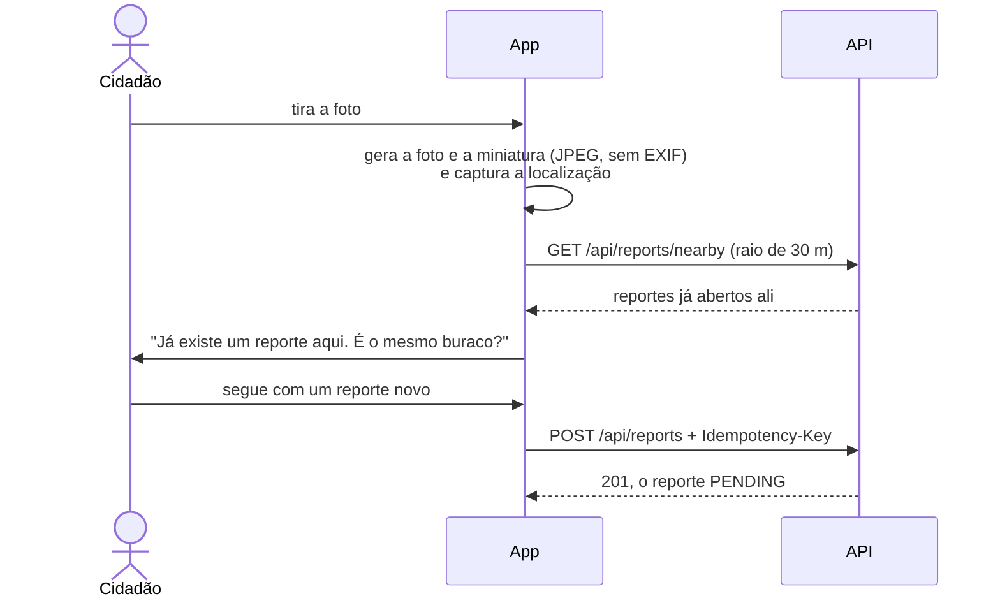
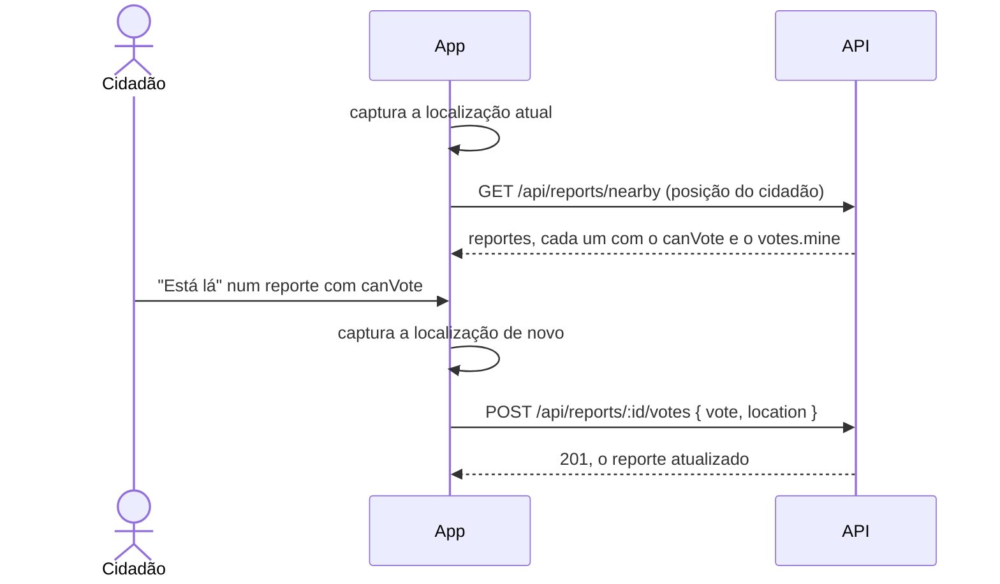

# Guia rápido para os times web e mobile

Como o painel web e o app fazem login e chamam a API do ReportaAi Cm. O funcionamento por dentro (sessão, guard e permissões) está no [AUTH.md](AUTH.md).

## O essencial

- A API fica sob `/api` (em dev, `http://localhost:3000/api`), e as rotas de login, sob `/api/auth`.
- O login é o mesmo para os três papéis: e-mail e senha no `POST /api/auth/signin`.
- **Use o SDK do SuperTokens.** Ele guarda os tokens, os envia nas requisições e renova a sessão sozinho quando o access token expira (a cada 15 minutos).
- Depois do login, chame o `GET /api/users/me` para saber **quem entrou e com qual papel**.
- Quem tem a verificação em duas etapas ativa ainda digita um código depois da senha ([verificação em duas etapas](#verificação-em-duas-etapas)).
- Os links dos e-mails da API (convite, redefinição de senha e verificação de e-mail) abrem páginas do painel web, inclusive para o Client, no navegador do celular ([páginas dos links](#páginas-abertas-pelos-links-dos-e-mails)).
- O app abre os reportes com a foto em base64, no JSON, e só com o e-mail confirmado ([reportes](#reportes)). Os cidadãos perto de um buraco confirmam ou negam o reporte de outro ([validação](#validar-os-reportes-de-outros-cidadãos)).

|                      | Painel web                                | App mobile (Flutter)                             |
| -------------------- | ----------------------------------------- | ------------------------------------------------ |
| SDK                  | `supertokens-web-js`                      | `supertokens_flutter`, com o `Dio`               |
| Onde os tokens ficam | Cookies httpOnly, que o JavaScript não lê | Headers, guardados pelo SDK no SharedPreferences |
| Papéis               | `SUPER_ADMIN` e `ADMIN`                   | `CLIENT`                                         |
| Cadastro             | Convite por e-mail (ADM)                  | Autocadastro (`POST /api/clients`)               |

Os exemplos abaixo seguem a API pública do `supertokens-web-js` 0.16 e do `supertokens_flutter` 0.6.5, compatíveis com o `supertokens-node` 24.0.3 do backend. As seções que valem para os dois fronts mostram a chamada com o `fetch`, em TypeScript: no app, a mesma chamada vai pelo `Dio`, com o mesmo corpo e as mesmas respostas.

> A API não sabe de qual front veio o login: um Client consegue se autenticar pelo painel, e um ADM, pelo app. As rotas já barram o papel errado (403), mas cabe a cada front conferir o `role` do `/users/me` e recusar quem não é do seu público.

## Painel web

```bash
npm install supertokens-web-js
```

Inicialize o SDK uma vez, na entrada da aplicação, antes de qualquer requisição:

```ts
import SuperTokens from 'supertokens-web-js';
import EmailPassword from 'supertokens-web-js/recipe/emailpassword';
import Session from 'supertokens-web-js/recipe/session';

SuperTokens.init({
  appInfo: {
    appName: 'ReportaAi Cm',
    apiDomain: 'http://localhost:3000', // sem o /api
    apiBasePath: '/api/auth',
  },
  recipeList: [Session.init(), EmailPassword.init()],
});
```

**Login:**

```ts
import { signIn } from 'supertokens-web-js/recipe/emailpassword';

try {
  const response = await signIn({
    formFields: [
      { id: 'email', value: email },
      { id: 'password', value: password },
    ],
  });

  if (response.status === 'OK') {
    // Sessão criada: os cookies já estão no navegador.
  } else if (response.status === 'FIELD_ERROR') {
    // E-mail fora do formato: response.formFields traz o erro de cada campo.
  } else {
    // WRONG_CREDENTIALS_ERROR: mostre "E-mail ou senha incorretos".
  }
} catch (error) {
  if (error.isSuperTokensGeneralError === true) {
    // GENERAL_ERROR: e-mail bloqueado por tentativas. Mostre o error.message.
  } else if (error instanceof Response && error.status === 429) {
    // Limite por IP: error.headers.get('Retry-After') traz os segundos de espera.
  } else {
    throw error;
  }
}
```

O `WRONG_CREDENTIALS_ERROR` também é a resposta para um usuário inativado, excluído ou com o convite pendente. A API não diferencia os casos, para não revelar se o e-mail tem conta.

**Bloqueio por tentativas.** Depois de 5 falhas de login para o mesmo e-mail em 15 minutos, a API responde `{ "status": "GENERAL_ERROR", "message": "Muitas tentativas. Tente novamente em alguns minutos." }` até uma das falhas sair da janela, mesmo com a senha correta. O `supertokens-web-js` não devolve esse status no `response`: ele lança um erro com `isSuperTokensGeneralError` e a `message` da API, como no `catch` acima. A resposta é a mesma para um e-mail sem conta.

**Limite por IP.** Acima de 20 tentativas de login por minuto do mesmo IP, a resposta é 429 ([erros](#erros)). O SDK também não devolve esse caso no `response`: para qualquer status HTTP a partir de 300, ele lança a própria `Response` do `fetch`, sem ler o corpo. Por isso o `catch` acima confere o `error.status`.

**Chamadas à API.** Depois do `init`, o SDK intercepta o `fetch` e o `XMLHttpRequest` (o axios funciona sem configuração extra). Nas requisições para o `apiDomain`, ele envia os cookies, renova a sessão quando recebe 401 e repete a chamada:

```ts
const response = await fetch('http://localhost:3000/api/users/me');
const me = await response.json(); // { id, role, name, email, status, ... }
```

**Sessão:**

```ts
import Session from 'supertokens-web-js/recipe/session';

await Session.doesSessionExist(); // true se há sessão (use para proteger as páginas)
await Session.signOut(); // encerra a sessão na API e limpa os cookies
```

**Em dev**, o painel precisa rodar na origem configurada no `WEB_APP_URL` da API (`http://localhost:5173` no `.env.example`): é a única que o CORS libera. Use `localhost` na API e no painel, sem misturar com `127.0.0.1`, senão o navegador não envia os cookies.

### Páginas abertas pelos links dos e-mails

Os e-mails da API levam a três páginas do painel. Os caminhos são fixos na API (`WEB_APP_URL` + caminho): se o painel mudar um deles, o backend precisa mudar junto.

| Página                           | E-mail que leva até ela                     | Rota chamada pela página                | Detalhes                                        |
| -------------------------------- | ------------------------------------------- | --------------------------------------- | ----------------------------------------------- |
| `/convite?token=<token>`         | Convite de ADM                              | `POST /api/invitations/accept`          | [Aceite do convite](#aceite-do-convite-de-adm)  |
| `/redefinir-senha?token=<token>` | "Esqueci minha senha", dos três papéis      | `POST /api/password-resets/confirm`     | [Esqueci minha senha](#esqueci-minha-senha)     |
| `/verificar-email?token=<token>` | Cadastro do Client e reenvio da verificação | `POST /api/email-verifications/confirm` | [Verificação de e-mail](#verificação-de-e-mail) |

Valem para as três:

- **São públicas.** Abrem sem sessão: o Client abre o link no navegador do celular, onde não tem a sessão do app. Não redirecione para o login.
- **Leia o `token` da URL** com `new URLSearchParams(window.location.search).get('token')`. Sem ele, mostre direto que o link é inválido, sem chamar a API.
- **O token é um segredo**: quem o tem redefine a senha ou ativa a conta. Não o envie para ferramentas de analytics nem para o log do front, e não deixe o navegador repassá-lo a outros sites no header `Referer` (`<meta name="referrer" content="no-referrer">` na página).
- **Cada link vale uma vez.** Depois do uso, a mesma chamada responde 422. Chame a rota uma única vez por envio do formulário (ou, na verificação de e-mail, por abertura da página).

### Aceite do convite de ADM

O e-mail de convite leva o ADM para **`<WEB_APP_URL>/convite?token=<token>`**. Essa página fica no painel:

1. Leia o `token` da URL e mostre um formulário para o ADM escolher a senha.
2. Envie o `POST /api/invitations/accept` com `{ "token": "...", "password": "..." }`. A rota é pública.
3. Com o 204, leve o ADM para a tela de login.

| Resposta | Significado                                                                                             |
| -------- | ------------------------------------------------------------------------------------------------------- |
| 204      | Senha definida e acesso ativado                                                                         |
| 400      | Senha fora da regra (de 8 a 128 caracteres, com pelo menos uma letra e um número)                       |
| 422      | Link inválido, expirado (48 horas), já usado ou substituído por um reenvio. O SuperAdm precisa reenviar |

## App mobile

O app é em Flutter e usa o `supertokens_flutter` com o `Dio`. No `pubspec.yaml`:

```yaml
dependencies:
  dio: 5.11.1
  supertokens_flutter: 0.6.5
```

O SDK guarda os tokens no SharedPreferences. Inicialize-o uma vez, no `main`, antes do `runApp`, e registre o interceptor dele no `Dio` que chama a API:

```dart
import 'package:dio/dio.dart';
import 'package:supertokens_flutter/dio.dart';
import 'package:supertokens_flutter/supertokens.dart';

SuperTokens.init(
  apiDomain: apiUrl, // ex.: http://10.0.2.2:3000 no emulador Android, sem o /api
  apiBasePath: '/api/auth',
  tokenTransferMethod: SuperTokensTokenTransferMethod.HEADER, // o padrão do SDK
  eventHandler: onSessionEvent, // ver "Quando a sessão acaba"
);

final dio = Dio(BaseOptions(baseUrl: '$apiUrl/api'));
dio.interceptors.add(SuperTokensInterceptorWrapper(client: dio));
```

**Cadastro.** O cidadão cria a conta pelo `POST /api/clients`, que é público, e o app faz o login em seguida:

```dart
final response = await dio.post<Map<String, dynamic>>(
  '/clients',
  data: {
    'name': 'Maria da Silva',
    'email': 'maria.silva@exemplo.com',
    'password': 'SenhaForte123',
    'cpf': '529.982.247-25',
    'phone': '(44) 99999-8888',
    'birthDate': '1990-05-20',
  },
);
// 201: conta criada. No 400 (campos inválidos) e no 409 (e-mail ou CPF já cadastrado), o Dio
// lança a DioException, com o corpo do erro no error.response.
```

**Login.** O SDK de Flutter cuida só da sessão, então o login é uma chamada direta à rota, pelo mesmo `Dio`. O interceptor guarda os tokens que voltam nos headers:

```dart
try {
  final response = await dio.post<Map<String, dynamic>>(
    '/auth/signin',
    data: {
      'formFields': [
        {'id': 'email', 'value': email},
        {'id': 'password', 'value': password},
      ],
    },
  );
  final result = response.data!;

  if (result['status'] == 'OK') {
    // Sessão criada: o SDK já guardou os tokens.
  } else if (result['status'] == 'GENERAL_ERROR') {
    // E-mail bloqueado por tentativas: mostre o result['message'].
  } else {
    // WRONG_CREDENTIALS_ERROR ou FIELD_ERROR (o status HTTP é 200 nos dois casos).
  }
} on DioException catch (error) {
  if (error.response?.statusCode == 429) {
    // Limite por IP: o header Retry-After traz os segundos de espera.
    final retryAfter = error.response?.headers.value('retry-after');
  } else {
    rethrow;
  }
}
```

O `GENERAL_ERROR` aparece depois de 5 falhas de login para o mesmo e-mail em 15 minutos e dura até uma delas sair da janela, mesmo com a senha correta. O 429 vem do limite por IP, acima de 20 tentativas por minuto, e tem o corpo no [formato de erro da aplicação](#erros), sem o campo `status`: com o `Dio`, ele chega como `DioException`, e não como resultado.

O interceptor cuida das requisições do `Dio` para o `apiDomain`: pede os tokens por header (`st-auth-mode: header`), guarda os que voltam na resposta, envia o access token no `Authorization` das chamadas seguintes e, num 401, renova a sessão e repete a chamada. A renovação e o signout saem por dentro do SDK, pelo pacote `http`, e não passam pelos interceptors do `Dio`.

Quando a sessão não renova mais, o interceptor do SDK entrega o 401 como uma resposta comum, sem lançar a `DioException`. Confira o status, ou registre depois do interceptor do SDK um interceptor que transforme o 401 em erro, como o app faz.

**Sessão:**

```dart
await SuperTokens.doesSessionExist(); // true se há sessão guardada (decide a tela inicial)
await SuperTokens.signOut(); // encerra a sessão na API e apaga os tokens
```

Os dois métodos não lançam erro sem rede:

- com o access token vencido e sem rede para renovar, o `doesSessionExist` responde `false`, mas não apaga os tokens: a sessão continua guardada para a próxima tentativa;
- o `signOut` só apaga os tokens depois que a API responde. Sem resposta, ele não lança erro e mantém os tokens no aparelho. O erro vai só para o `completionHandler`, e nem sempre: com o access token vencido e sem rede para renovar, o SDK nem chama a API.

Para saber se ainda há tokens guardados, sem chamar a API, use o `SuperTokens.getUserId()`: ele lê o front token e lança a `SuperTokensException` quando não há sessão.

**Em dev**, o `localhost` do aparelho não é o da sua máquina. Use `http://10.0.2.2:3000` no emulador Android, `http://localhost:3000` no simulador do iOS ou no celular com o `adb reverse tcp:3000 tcp:3000`, e o IP da máquina na rede num aparelho físico pelo Wi-Fi. O app não passa pelo CORS. O passo a passo está no [README do app](https://github.com/jgtsuchiya/projeto_integrador_reportaAiCm_mobile#conectando-à-api-local).

## Esqueci minha senha

A recuperação de senha é igual para os três papéis e tem duas etapas: o pedido do link, feito no painel e no app, e a página que define a senha nova, que fica só no painel web.

**1. Pedido do link (painel e app).** Na tela "Esqueci minha senha", envie o e-mail para a rota pública:

```ts
const response = await fetch(`${API_URL}/api/password-resets`, {
  method: 'POST',
  headers: { 'Content-Type': 'application/json' },
  body: JSON.stringify({ email }),
});
// 204: mostre "Se este e-mail tiver uma conta, você vai receber um link para redefinir a senha".
```

- A resposta é **sempre 204**, exista ou não a conta. Mostre a mesma mensagem nos dois casos, sem dizer que o e-mail não foi encontrado.
- A mesma conta recebe **um e-mail por minuto**. Um pedido repetido antes disso também responde 204, mas não envia nada. Deixe o botão de reenviar desativado por 1 minuto.
- Só recebe o link a conta ativa. O ADM com o convite pendente continua dependendo do convite.

**2. Página `/redefinir-senha` (painel web).** O e-mail leva o usuário para **`<WEB_APP_URL>/redefinir-senha?token=<token>`**. O Client abre o link no navegador do celular:

1. Leia o `token` da URL e mostre um formulário para o usuário escolher a senha.
2. Envie o `POST /api/password-resets/confirm` com `{ "token": "...", "password": "..." }`. A rota é pública.
3. Com o 204, leve o ADM ou o SuperAdm para a tela de login. Para o Client, mostre que a senha foi alterada e peça para ele voltar ao app. A página não sabe o papel de quem redefiniu, então uma mensagem só serve aos dois casos.

```ts
const token = new URLSearchParams(window.location.search).get('token');

const response = await fetch(`${API_URL}/api/password-resets/confirm`, {
  method: 'POST',
  headers: { 'Content-Type': 'application/json' },
  body: JSON.stringify({ token, password }),
});

if (response.status === 204) {
  // "Sua senha foi alterada. Entre com a senha nova no painel ou no app."
} else if (response.status === 400) {
  const { details } = await response.json(); // [{ field: 'password', message: '...' }]
  // Senha fora da regra: mostre a message do campo. O link continua valendo.
} else if (response.status === 422) {
  // Link inválido ou expirado: ofereça pedir outro, na tela "Esqueci minha senha".
} else if (response.status === 429) {
  // Muitas tentativas do mesmo IP: o header Retry-After traz os segundos de espera.
}
```

Valide a senha no formulário com a [regra do campo](#regras-dos-campos) antes de enviar, para evitar uma ida à API.

| Rota                                | Resposta | Significado                                                                                                 |
| ----------------------------------- | -------- | ----------------------------------------------------------------------------------------------------------- |
| `POST /api/password-resets`         | 204      | Pedido recebido. Não diz se o e-mail tem conta                                                              |
| `POST /api/password-resets`         | 400      | E-mail fora do formato                                                                                      |
| `POST /api/password-resets/confirm` | 204      | Senha redefinida                                                                                            |
| `POST /api/password-resets/confirm` | 400      | Senha fora da regra (de 8 a 128 caracteres, com pelo menos uma letra e um número). O link continua valendo  |
| `POST /api/password-resets/confirm` | 422      | Link inválido, expirado (60 minutos), já usado ou substituído por um pedido novo. O usuário pede outro link |
| As duas                             | 429      | Muitas requisições do mesmo IP ([erros](#erros))                                                            |

Depois da redefinição, **todas as sessões do usuário são encerradas**, em todos os aparelhos, e ele recebe o e-mail "Sua senha foi alterada". O mesmo aviso sai na troca de senha pelo perfil. A redefinição também libera o login de um e-mail [bloqueado por tentativas](AUTH.md#bloqueio-do-login-por-tentativas).

## Verificação de e-mail

O Client nasce com o e-mail **não verificado** e recebe, no cadastro, um e-mail com o link de confirmação. O login não depende disso: ele entra no app normalmente. O ADM e o SuperAdm já nascem verificados, então isto vale só para o app e para uma página do painel.

**1. No app: situação e reenvio.** O `emailVerifiedAt` do `GET /api/users/me` é `null` enquanto o e-mail não for confirmado. Mostre um aviso ("Confirme o seu e-mail") com a opção de reenviar o link:

```ts
// Com a sessão do Client (o SDK envia os tokens).
const response = await fetch(`${API_URL}/api/users/me/email-verification`, { method: 'POST' });
// 204: mostre "Enviamos um novo link para o seu e-mail".
```

- O link novo **invalida os anteriores**.
- A mesma conta recebe **um e-mail por minuto**, contando o do cadastro. Antes disso, a rota responde 422 e o link que já foi continua valendo. Deixe o botão de reenviar desativado por 1 minuto, inclusive logo depois do cadastro.
- Para saber que o e-mail foi confirmado, chame o `GET /api/users/me` de novo, por exemplo quando o app volta para o primeiro plano.

**2. Página `/verificar-email` (painel web).** O e-mail leva o Client para **`<WEB_APP_URL>/verificar-email?token=<token>`**, que abre no navegador do celular:

1. Leia o `token` da URL e envie o `POST /api/email-verifications/confirm` com `{ "token": "..." }`, sozinho, quando a página abre. A rota é pública: no navegador, o Client não tem a sessão do app.
2. Com o 204, mostre que o e-mail foi confirmado e peça para ele voltar ao app.
3. Com o 422, mostre que o link não vale mais e oriente a pedir outro pelo app.

```ts
const token = new URLSearchParams(window.location.search).get('token');

const response = await fetch(`${API_URL}/api/email-verifications/confirm`, {
  method: 'POST',
  headers: { 'Content-Type': 'application/json' },
  body: JSON.stringify({ token }),
});

if (response.status === 204) {
  // "E-mail confirmado. Pode voltar ao app."
} else if (response.status === 429) {
  // Muitas tentativas do mesmo IP: o header Retry-After traz os segundos de espera.
} else {
  // 422 (ou 400, para um token vazio): "Este link não vale mais. Se você já confirmou o
  // e-mail, não precisa fazer nada. Se não, peça outro link pelo app."
}
```

- **Chame a rota uma vez só.** O link é de uso único: uma segunda chamada com o mesmo token responde 422, mesmo com o e-mail já confirmado. Cuidado com o React em modo estrito (`StrictMode`), que roda os efeitos duas vezes em dev.
- Pelo mesmo motivo, a mensagem do 422 não deve afirmar que o e-mail não foi confirmado: quem abre de novo um link que já usou também recebe 422.

| Rota                                    | Resposta | Significado                                                                                             |
| --------------------------------------- | -------- | ------------------------------------------------------------------------------------------------------- |
| `POST /api/email-verifications/confirm` | 204      | E-mail confirmado                                                                                       |
| `POST /api/email-verifications/confirm` | 422      | Link inválido, expirado (24 horas), já usado ou substituído por um reenvio. O Client pede outro link    |
| `POST /api/email-verifications/confirm` | 429      | Muitas requisições do mesmo IP ([erros](#erros))                                                        |
| `POST /api/users/me/email-verification` | 204      | Link novo enviado                                                                                       |
| `POST /api/users/me/email-verification` | 422      | O e-mail já foi verificado, ou o último e-mail saiu há menos de 1 minuto. A `message` diz qual dos dois |

Se o e-mail do cadastro não chegar (o servidor de e-mail pode falhar), o cadastro vale do mesmo jeito: o Client pede o reenvio.

## Verificação em duas etapas

Para quem tem a verificação em duas etapas ativa, a senha é só a primeira etapa: o login responde `OK` e cria a sessão, mas ela fica **pendente** até o usuário digitar o código de 6 dígitos que a API envia para o e-mail dele. Vale para os três papéis, no painel e no app.

**Ativar e desativar.** A opção fica nas configurações da conta, no painel e no app. O usuário liga ou desliga e confirma com a senha atual:

```ts
const response = await fetch(`${API_URL}/api/users/me/mfa`, {
  method: 'PATCH',
  headers: { 'Content-Type': 'application/json' },
  body: JSON.stringify({ enabled: true, password }), // enabled: false para desativar
});
// 200: o corpo é o perfil atualizado, com o mfaEnabled.
```

- O estado atual vem no `mfaEnabled` do [`GET /api/users/me`](#depois-do-login-perfil-e-papel).
- **Ativar exige o e-mail verificado** (`emailVerifiedAt` preenchido). Sem ele, a resposta é 422. No app, enquanto o Client não confirmar o e-mail, mostre a opção de [reenviar a verificação](#verificação-de-e-mail) no lugar do botão de ativar.
- **Ativar encerra as outras sessões da conta**, que caem na renovação seguinte, em até 15 minutos, e pedem o código no próximo login. O aparelho que ativou continua logado, sem pedir o código. Avise o usuário antes de confirmar.
- Desativar não encerra nenhuma sessão. Ativar o que já está ativo, ou desativar o que já está desativado, responde 200 sem efeito.
- A senha incorreta responde **422**, com `details.field` igual a `password`: mostre o erro no campo da senha ([erros](#erros)).

O login de quem ativou segue os três passos abaixo.

**1. Depois do login, confira se a sessão está pendente.** A situação vem na claim `mfa-verified` do access token, que o SDK lê sem chamar a API:

```ts
// Painel web.
const payload = await Session.getAccessTokenPayloadSecurely();
const pending = payload['mfa-verified']?.v === false;
```

```dart
// App.
final payload = await SuperTokens.getAccessTokenPayloadSecurely();
final pending = payload['mfa-verified']?['v'] == false;
```

- Com `pending`, leve o usuário para a tela do código, em vez de chamar o `GET /api/users/me`.
- Faça a mesma conferência ao abrir o app ou o painel com uma sessão já guardada: o usuário pode ter fechado tudo antes de digitar o código.
- Enquanto a sessão está pendente, as outras rotas respondem **403** com `{ "message": "invalid claim", "claimValidationErrors": [{ "id": "mfa-verified", ... }] }`. Se uma chamada receber essa resposta, leve o usuário para a tela do código. Não é o 403 de "sem permissão", que tem o [formato de erro da aplicação](#erros).
- A sessão pendente renova o token e faz o signout normalmente. O botão "Sair" da tela do código usa o `signOut` do SDK.

**2. Tela do código.** Envie o código digitado, com a sessão pendente (o SDK envia os tokens):

```ts
const response = await fetch(`${API_URL}/api/mfa/verify`, {
  method: 'POST',
  headers: { 'Content-Type': 'application/json' },
  body: JSON.stringify({ code }), // texto com 6 dígitos, ex.: "042137"
});
// 204: login concluído. Siga para o GET /api/users/me.
```

- A resposta 204 já traz o access token atualizado, que o SDK guarda sozinho. As chamadas seguintes passam.
- O código vale **10 minutos** e só pode ser usado uma vez. **Cinco erros invalidam o código**, mesmo que a tentativa seguinte esteja certa: mostre a opção de pedir outro.
- Envie o código como texto, com os zeros à esquerda. Um código fora do formato responde 400 e não conta como erro.

**3. Reenvio do código.** O `POST /api/mfa/code`, com a sessão pendente, envia um código novo, que **invalida o anterior**:

- A mesma conta recebe **um código por minuto**, contando o do login. Antes disso, a rota responde 422, e o código que já foi continua valendo. Deixe o botão de reenviar desativado por 1 minuto, inclusive logo depois do login.
- Se o usuário fizer o login de novo em menos de 1 minuto (por exemplo, em outro aparelho), a API não envia outro código: vale o do e-mail que ele já recebeu.

| Rota                                | Resposta | Significado                                                                                                                  |
| ----------------------------------- | -------- | ---------------------------------------------------------------------------------------------------------------------------- |
| `PATCH /api/users/me/mfa`           | 200      | Verificação ativada ou desativada. O corpo é o perfil, com o `mfaEnabled`                                                    |
| `PATCH /api/users/me/mfa`           | 400      | Falta o `enabled` (booleano) ou a senha                                                                                      |
| `PATCH /api/users/me/mfa`           | 422      | Senha incorreta (`details.field` igual a `password`) ou ativação com o e-mail ainda não verificado                           |
| `POST /api/mfa/verify`              | 204      | Código conferido e login concluído                                                                                           |
| `POST /api/mfa/verify`              | 400      | Código fora do formato (6 dígitos)                                                                                           |
| `POST /api/mfa/verify`              | 422      | Código errado, vencido, já usado ou invalidado por 5 erros. O usuário tenta de novo ou pede outro código                     |
| `POST /api/mfa/code`                | 204      | Código novo enviado                                                                                                          |
| `POST /api/mfa/code`                | 422      | O último código saiu há menos de 1 minuto                                                                                    |
| `/api/mfa/verify` e `/api/mfa/code` | 422      | A sessão não está pendente (o login já foi concluído, ou a conta não tem a verificação em duas etapas). A `message` diz qual |
| Outras rotas, com a sessão pendente | 403      | `{ "message": "invalid claim", ... }`: falta o código                                                                        |

Se o e-mail com o código não chegar (o servidor de e-mail pode falhar), o login vale do mesmo jeito: o usuário pede o reenvio depois de 1 minuto.

## Depois do login: perfil e papel

```http
GET /api/users/me
```

```json
{
  "id": "48550ab5-e0ae-44e9-a646-997c89a9fdb4",
  "role": "CLIENT",
  "name": "Maria da Silva",
  "email": "maria.silva@exemplo.com",
  "status": "ACTIVE",
  "emailVerifiedAt": null,
  "mfaEnabled": false,
  "lastLoginAt": "2026-10-04T23:57:35.427Z",
  "createdAt": "2026-10-04T23:57:35.237Z",
  "updatedAt": "2026-10-04T23:57:35.237Z",
  "cpf": "52998224725",
  "phone": "44999998888",
  "birthDate": "1990-05-20"
}
```

- `role` é `SUPER_ADMIN`, `ADMIN` ou `CLIENT`, e não muda depois que a conta é criada.
- `emailVerifiedAt` é `null` até o Client confirmar o e-mail ([verificação de e-mail](#verificação-de-e-mail)). No ADM e no SuperAdm, vem sempre preenchido.
- `mfaEnabled` diz se o login da conta pede o código da [verificação em duas etapas](#verificação-em-duas-etapas).
- `cpf`, `phone` e `birthDate` só existem para o Client. CPF e telefone vêm só com dígitos: a máscara é por conta do front.
- No painel, o CPF dos Clients vem sempre mascarado (`***.982.247-**`) nas rotas de `/api/clients`.

## Sessões abertas

O usuário, de qualquer papel, vê onde a conta está aberta e encerra o acesso de outros aparelhos. A tela "Onde você está conectado" vale para o painel e para o app:

```http
GET /api/users/me/sessions
```

```json
[
  {
    "id": "5a1c9f0e-3b7d-4c2a-9e41-0d6f8b2a7c13",
    "createdAt": "2026-10-06T12:00:00.000Z",
    "expiresAt": "2026-10-13T12:00:00.000Z",
    "ipAddress": "203.0.113.10",
    "userAgent": "Mozilla/5.0 (X11; Linux x86_64)",
    "current": true
  }
]
```

- A lista vem da sessão mais recente para a mais antiga, sem paginação. `createdAt` é a data do login.
- `current` é `true` só na sessão que fez a requisição. Mostre-a como "este aparelho", sem o botão de encerrar: para sair dela, use o `signOut` do SDK.
- `ipAddress` e `userAgent` são os do login e podem vir `null`, como nas sessões abertas antes de esta listagem existir. O `userAgent` é o texto cru do header: transformar em "Chrome no Linux" é por conta do front.

| Rota                                | Resposta | Significado                                                          |
| ----------------------------------- | -------- | -------------------------------------------------------------------- |
| `GET /api/users/me/sessions`        | 200      | Lista das sessões abertas                                            |
| `DELETE /api/users/me/sessions/:id` | 204      | Sessão encerrada. O `:id` é o `id` da listagem                       |
| `DELETE /api/users/me/sessions/:id` | 404      | A sessão não existe mais (ex.: já foi encerrada). Recarregue a lista |
| `DELETE /api/users/me/sessions`     | 204      | Todas as outras sessões encerradas. A atual continua aberta          |

O aparelho da sessão encerrada não cai na hora: ele perde o acesso na renovação seguinte do token, em até 15 minutos.

## Reportes

O cidadão abre um reporte de buraco com a foto e a localização do aparelho, e acompanha, edita e exclui os próprios reportes. Os outros cidadãos, perto do buraco, dizem se ele está lá ou não ([validação](#validar-os-reportes-de-outros-cidadãos)). As rotas são só do Client: o ADM e o SuperAdm recebem 403. Como a API trata a foto, a localização e os votos por dentro está no [REPORTS.md](REPORTS.md).



### Antes de abrir

- **E-mail confirmado.** Sem ele, o `POST /api/reports` responde 422 "Confirme o seu e-mail para abrir reportes.". Confira o `emailVerifiedAt` do `GET /api/users/me` antes de mostrar o formulário ([verificação de e-mail](#verificação-de-e-mail)). Depois da confirmação, a mesma sessão já abre reportes.
- **A foto e a miniatura, geradas no app.** A API não redimensiona nem gira a imagem: ela só confere e tira os metadados.

| Imagem      | Formato | Tamanho máximo | Maior lado | Campo             |
| ----------- | ------- | -------------- | ---------- | ----------------- |
| A foto      | JPEG    | 2 MB           | 2048 px    | `photo.content`   |
| A miniatura | JPEG    | 100 KB         | 480 px     | `photo.thumbnail` |

- Aplique a orientação nos pixels: a API não lê a orientação do EXIF. Tire o EXIF no app também (ele pode ter o GPS e o modelo do aparelho): a API o tira de novo, por garantia.
- A API confere o formato pelos bytes: PNG, WebP e HEIC são recusados, mesmo com outro nome. Os tamanhos são os da imagem, antes do base64.
- **A localização.** Precisão de até 50 m e dentro de Campo Mourão. A precisão vai em metros (`accuracyMeters`, maior que zero) e volta arredondada para cima.
- **Reporte repetido.** Antes de enviar, consulte o `GET /api/reports/nearby` com raio de 30 m e pergunte ao cidadão se o buraco é o mesmo.

### Abrir o reporte

```http
POST /api/reports
Idempotency-Key: 3b241101-e2bb-4255-8caf-4136c566a962
```

```json
{
  "description": "Buraco grande na faixa da direita, perto do semáforo.",
  "location": { "latitude": -24.045812, "longitude": -52.378901, "accuracyMeters": 8.5 },
  "photo": {
    "content": "/9j/4AAQSkZJRgABAQAAAQABAAD...",
    "thumbnail": "/9j/4AAQSkZJRgABAQAAAQABAAD..."
  }
}
```

- O base64 é o padrão (RFC 4648), com o `=` do fim, sem quebra de linha e sem o prefixo `data:image/jpeg;base64,`. No Dart, é o que o `base64Encode` do `dart:convert` gera.
- A `description` é opcional, de até 500 caracteres. Vazia ou `null`, o reporte fica sem descrição.
- **`Idempotency-Key`.** Crie um UUID quando a tela abre e envie o mesmo em todas as tentativas daquele reporte. Se a resposta se perder (timeout, rede caiu) e o app repetir, a API devolve o reporte já criado, com 201, em vez de criar outro, e ele não conta de novo no limite por dia. Uma chave que não é UUID responde 400. Se o cidadão excluiu o reporte da chave, a repetição responde 404.
- **Tempo limite.** A foto pode levar alguns segundos para subir em rede móvel: use um tempo limite maior que o padrão do `Dio` no envio e na resposta (o plano do app usa 60 s).
- **Não registre no log** o base64 nem as coordenadas, nem no corpo, nem na query.

```dart
final response = await dio.post<Map<String, dynamic>>(
  '/reports',
  data: {
    'description': description,
    'location': {'latitude': lat, 'longitude': lng, 'accuracyMeters': accuracy},
    'photo': {'content': base64Encode(photoBytes), 'thumbnail': base64Encode(thumbnailBytes)},
  },
  options: Options(
    headers: {'Idempotency-Key': idempotencyKey},
    sendTimeout: const Duration(seconds: 60),
    receiveTimeout: const Duration(seconds: 60),
  ),
);
```

A resposta (201) é o reporte, no mesmo formato de todas as rotas de reportes:

```json
{
  "id": "8f0e2c4a-6b1d-4c7e-9a52-3d6f1e0b7a91",
  "status": "PENDING",
  "description": "Buraco grande na faixa da direita, perto do semáforo.",
  "location": { "latitude": -24.045812, "longitude": -52.378901, "accuracyMeters": 9 },
  "photo": { "id": "c1b7d0e2-2f4a-4b8e-9d61-5a3c7e8f9b10", "width": 1600, "height": 1200 },
  "votes": {
    "confirmations": 0,
    "rejections": 0,
    "confirmationsRequired": 10,
    "rejectionsRequired": 10,
    "mine": null
  },
  "isMine": true,
  "canEdit": true,
  "canDelete": true,
  "canVote": false,
  "createdAt": "2026-11-09T14:30:00.000Z",
  "updatedAt": "2026-11-09T14:30:00.000Z",
  "statusChangedAt": null
}
```

- `status`: `PENDING` ("Em validação"), `CONFIRMED` ou `REJECTED`. Os status do atendimento pela prefeitura entram depois: trate um valor desconhecido sem quebrar.
- `votes` traz as contagens e quantas são necessárias, para o app mostrar "3 de 10 confirmações", e o `mine`: o voto de quem está logado (`"CONFIRM"`, `"DENY"` ou `null`). As contagens mudam com a [validação](#validar-os-reportes-de-outros-cidadãos).
- `statusChangedAt` é quando o reporte saiu de validação (virou CONFIRMED ou REJECTED). Em PENDING, é `null`.
- **`isMine`, `canEdit`, `canDelete` e `canVote`** já vêm calculados para quem está logado. Mostre os botões de editar, excluir e votar a partir deles, sem repetir as regras no app.
- A resposta nunca traz quem abriu o reporte: o `isMine` basta.
- `photo` traz só o id e as dimensões da foto. As imagens vêm pelo `GET /api/reports/:id/photo`.

### Consultar

| Rota                                                                 | Resposta                                                                                                                                                                                       |
| -------------------------------------------------------------------- | ---------------------------------------------------------------------------------------------------------------------------------------------------------------------------------------------- |
| `GET /api/reports/mine?page=1&pageSize=20&status=PENDING`            | Os reportes do cidadão, em qualquer status, do mais novo ao mais antigo: `{ items, page, pageSize, total }`. O `status` é opcional                                                             |
| `GET /api/reports/nearby?latitude=...&longitude=...&radiusMeters=30` | Os reportes PENDING e CONFIRMED de qualquer cidadão, do mais perto ao mais longe, até 50: `{ items }`, cada um com o `distanceMeters` (inteiro). O raio vai de 10 a 5000 m, com padrão de 1000 |
| `GET /api/reports/:id`                                               | O reporte                                                                                                                                                                                      |
| `GET /api/reports/:id/photo?size=thumbnail`                          | `{ id, mimeType, content }`, com o `content` em base64. `size` é `full` (padrão) ou `thumbnail`                                                                                                |

- O cidadão vê os próprios reportes em qualquer status, e os dos outros só em PENDING e CONFIRMED. Fora disso, e no reporte excluído, a resposta é 404.
- **Cache das fotos.** O `id` da foto muda quando ela é trocada: use-o como chave do cache, e o cache nunca mostra a foto antiga. Nas listas, carregue as miniaturas (`size=thumbnail`) só quando o item aparece.

```dart
final response = await dio.get<Map<String, dynamic>>(
  '/reports/$reportId/photo',
  queryParameters: {'size': 'thumbnail'},
);
final bytes = base64Decode(response.data!['content'] as String);
// Image.memory(bytes), em cache pelo response.data!['id'].
```

### Editar e excluir

```http
PATCH /api/reports/8f0e2c4a-6b1d-4c7e-9a52-3d6f1e0b7a91
```

```json
{ "description": "" }
```

- O `PATCH` aceita a `description` e a `photo` (no mesmo formato do `POST`), pelo menos uma, e responde o reporte. `""` (ou `null`) apaga a descrição, e o campo ausente não muda. A localização não muda.
- A foto nova ganha outro `photo.id`: atualize a chave do cache.
- O `DELETE /api/reports/:id` responde 204. O reporte some de todas as rotas, e continua contando no limite de 10 por dia.
- Só o autor edita e exclui, e só enquanto o reporte está em validação. A edição também exige que ninguém tenha votado. O `canEdit` e o `canDelete` já dizem isso, mas um voto pode chegar enquanto o autor edita: trate o 422 e atualize o reporte.

### Validar os reportes de outros cidadãos

Na tela de validação, o cidadão vê os reportes em validação perto de onde está e diz se o buraco está lá ("Está lá", `CONFIRM`) ou não ("Não está lá", `DENY`). Com 10 confirmações, o reporte vira CONFIRMED e passa a ser considerado verdadeiro. Com 10 votos "não está lá", vira REJECTED e some para os outros cidadãos. O autor continua vendo o próprio reporte em qualquer status.



**1. A lista.** Chame o `GET /api/reports/nearby` com a localização atual do cidadão (ex.: `radiusMeters=1000`). Cada item traz:

- `canVote`: `true` quando o reporte está em validação, é de outro cidadão, ele ainda não votou e o reporte está a até 500 m do ponto consultado. Mostre os botões de voto só nesses. Os outros itens podem aparecer sem os botões (ex.: "Você já votou" quando o `votes.mine` não é `null`, ou "Chegue mais perto para votar").
- `votes.mine`: o voto do cidadão (`"CONFIRM"`, `"DENY"` ou `null`).
- `votes.confirmations` de `votes.confirmationsRequired`, para a barra de progresso.
- `distanceMeters`: a distância até o ponto consultado.

O `canVote` não confere o e-mail: o cidadão sem o e-mail confirmado vê os botões e recebe o 422 "Confirme o seu e-mail para votar nos reportes.", que explica o que fazer. Se quiser, esconda os botões pelo `emailVerifiedAt` do `GET /api/users/me`.

**2. O voto.**

```http
POST /api/reports/8f0e2c4a-6b1d-4c7e-9a52-3d6f1e0b7a91/votes
```

```json
{
  "vote": "CONFIRM",
  "location": { "latitude": -24.045903, "longitude": -52.378766, "accuracyMeters": 12 }
}
```

- `vote`: `"CONFIRM"` ("está lá") ou `"DENY"` ("não está lá"), em maiúsculas.
- `location`: a localização **atual** do aparelho, capturada na hora do voto, e não a da lista: o cidadão precisa estar a até 500 m do reporte, com precisão de até 50 m. Recuse no app a posição simulada (`isMocked` no Android).
- A API só confere a localização de quem vota: ela não é gravada nem devolvida. **Não a registre no log** do app.
- **O voto é definitivo.** Não há como mudar nem desfazer: confirme a escolha antes de enviar, se a tela deixar o toque acidental fácil.
- A resposta (201) é o reporte atualizado, no formato de sempre, com o `votes.mine` preenchido e o `canVote: false`. Troque o item da lista por ele. Se o `status` veio `CONFIRMED` ou `REJECTED`, foi este voto que fechou a validação.

```dart
try {
  final response = await dio.post<Map<String, dynamic>>(
    '/reports/$reportId/votes',
    data: {
      'vote': confirmed ? 'CONFIRM' : 'DENY',
      'location': {'latitude': lat, 'longitude': lng, 'accuracyMeters': accuracy},
    },
  );
  updateItem(response.data!);
} on DioException catch (error) {
  final status = error.response?.statusCode;
  if (status == 409 || status == 404 || status == 422) {
    // 409: já votou. 404: o reporte sumiu. 422: a message explica (ex.: longe demais).
    showMessage(error.response!.data['message'] as String);
    refreshList();
  } else {
    rethrow;
  }
}
```

**3. As respostas de erro.**

| Status | Quando                                                                                 | O que o app faz                                                       |
| ------ | -------------------------------------------------------------------------------------- | --------------------------------------------------------------------- |
| 400    | `vote` fora de `CONFIRM` e `DENY`, ou a localização inválida. O `details` traz o campo | Não deveria acontecer: confira o corpo                                |
| 404    | O reporte foi excluído pelo autor ou descartado (REJECTED) por outros votos            | Tira o item da lista                                                  |
| 409    | "Você já votou neste reporte." (ex.: o voto foi gravado, mas a resposta se perdeu)     | Atualiza o item com o `GET /api/reports/:id`, que traz o `votes.mine` |
| 422    | Regra do voto, com a `message` pronta para exibir (tabela abaixo)                      | Mostra a `message` e atualiza o item                                  |

| Situação (422)              | `message`                                                       |
| --------------------------- | --------------------------------------------------------------- |
| E-mail não confirmado       | "Confirme o seu e-mail para votar nos reportes."                |
| O próprio reporte           | "Você não pode votar no próprio reporte."                       |
| O reporte já foi confirmado | "Este reporte não está mais em validação."                      |
| Mais de 500 m do reporte    | "Você precisa estar a até 500 m do reporte para votar."         |
| Precisão pior que 50 m      | "A localização está imprecisa. Tente de novo num lugar aberto." |

Diferente do `POST /api/reports`, o voto não tem `Idempotency-Key`: se a resposta se perder e o app repetir, a repetição responde 409, e o voto já está gravado.

### Erros dos reportes

| Status | Quando                                                                                                        | O que o app faz                                                   |
| ------ | ------------------------------------------------------------------------------------------------------------- | ----------------------------------------------------------------- |
| 400    | Campo inválido. O `details` traz o campo (ex.: `photo.content`, `location.accuracyMeters`, `Idempotency-Key`) | Mostra a `message` de cada campo. Na foto, gere a imagem de novo  |
| 403    | Editar ou excluir o reporte de outro cidadão                                                                  | Não deveria acontecer se o app seguir o `canEdit` e o `canDelete` |
| 404    | O reporte não existe, foi excluído ou não está visível para o cidadão                                         | Volta para a lista e a atualiza                                   |
| 409    | Voto repetido no mesmo reporte                                                                                | Atualiza o reporte, que já traz o `votes.mine`                    |
| 413    | O corpo passa do limite das rotas de reportes (cerca de 2,8 MB)                                               | Gera a foto com mais compressão e tenta de novo                   |
| 422    | Regra de negócio, com a `message` pronta para exibir (tabela abaixo)                                          | Mostra a `message`                                                |

| Situação (422)            | `message`                                                       |
| ------------------------- | --------------------------------------------------------------- |
| E-mail não confirmado     | "Confirme o seu e-mail para abrir reportes."                    |
| Fora de Campo Mourão      | "Este lugar fica fora de Campo Mourão."                         |
| Precisão pior que 50 m    | "A localização está imprecisa. Tente de novo num lugar aberto." |
| Limite por dia            | "Você chegou ao limite de 10 reportes por dia."                 |
| Editar com votos          | "O reporte já recebeu votos e não pode mais ser editado."       |
| Editar fora de validação  | "Só é possível editar um reporte em validação."                 |
| Excluir fora de validação | "Só é possível excluir um reporte em validação."                |

As mensagens do voto estão em [validar os reportes](#validar-os-reportes-de-outros-cidadãos). As mensagens de 400 da foto dizem qual das imagens falhou: "A foto precisa ser uma imagem JPEG.", "A foto passa de 2 MB.", "A foto passa de 2048 px no maior lado.", "A foto precisa estar em base64, sem o prefixo "data:"." e as equivalentes para a miniatura.

## Quando a sessão acaba

A renovação do access token é automática e o usuário não percebe. A sessão termina de vez quando:

- o usuário sai (`signOut`);
- o refresh token expira, depois de 7 dias sem uso;
- o usuário é inativado ou excluído: o bloqueio vale na requisição seguinte;
- a sessão é encerrada em outro aparelho, pela lista de [sessões abertas](#sessões-abertas): ela cai na renovação seguinte, em até 15 minutos;
- a senha é trocada em outro aparelho: as outras sessões caem na renovação seguinte, em até 15 minutos, e a de quem trocou continua;
- a verificação em duas etapas é ativada em outro aparelho: as outras sessões caem do mesmo jeito, e a de quem ativou continua;
- a senha é redefinida pelo link do e-mail: todas as sessões caem na renovação seguinte, em até 15 minutos.

Nesses casos, a API responde 401, o SDK apaga os tokens e avisa o evento `UNAUTHORISED`: no painel, pelo `onHandleEvent`, e no app, pelo `eventHandler`. Use o evento para levar o usuário à tela de login:

```ts
// Painel web: Session.init({ onHandleEvent }).
function onHandleEvent(event: { action: string }) {
  if (event.action === 'UNAUTHORISED' || event.action === 'SIGN_OUT') {
    // Ir para a tela de login.
  }
}
```

```dart
// App: SuperTokens.init(..., eventHandler: onSessionEvent).
void onSessionEvent(Eventype event) {
  if (event == Eventype.UNAUTHORISED) {
    // Ir para a tela de login, com o aviso de que a sessão expirou.
  }
}
```

No app, o `Eventype.SIGN_OUT` chega também quando o `signOut` não alcançou a API e os tokens continuam no aparelho. Antes de levar ao login por ele, confira se ainda há sessão guardada.

## Rotas de cada front

| Rota                                                                        | Painel web | App | Observação                                                      |
| --------------------------------------------------------------------------- | :--------: | :-: | --------------------------------------------------------------- |
| `POST /api/auth/signin`, `/session/refresh` e `/signout`                    |     ✔      |  ✔  | Pelo SDK                                                        |
| `GET` e `PATCH /api/users/me`                                               |     ✔      |  ✔  | O Client também edita `phone` e `birthDate`                     |
| `PATCH /api/users/me/password`                                              |     ✔      |  ✔  | `{ currentPassword, newPassword }`. Senha atual errada: 422     |
| `/api/users/me/sessions` (listagem, encerrar uma, encerrar as outras)       |     ✔      |  ✔  | Sessões abertas do usuário logado, de qualquer papel            |
| `PATCH /api/users/me/mfa`                                                   |     ✔      |  ✔  | `{ enabled, password }`. Ativar exige o e-mail verificado       |
| `POST /api/mfa/verify` e `POST /api/mfa/code`                               |     ✔      |  ✔  | Tela do código da segunda etapa, com a sessão pendente          |
| `POST /api/password-resets`                                                 |     ✔      |  ✔  | "Esqueci minha senha", sem sessão. Responde sempre 204          |
| `POST /api/password-resets/confirm`                                         |     ✔      |     | Página `/redefinir-senha`, sem sessão                           |
| `POST /api/clients`                                                         |            |  ✔  | Autocadastro, sem sessão. Envia o link de verificação de e-mail |
| `POST /api/users/me/email-verification`                                     |            |  ✔  | Reenvia o link de verificação. Só para quem ainda não verificou |
| `POST /api/email-verifications/confirm`                                     |     ✔      |     | Página `/verificar-email`, sem sessão                           |
| `DELETE /api/users/me`                                                      |            |  ✔  | `{ password }`. Exclui e anonimiza a conta do Client            |
| `POST /api/invitations/accept`                                              |     ✔      |     | Página `/convite`, sem sessão                                   |
| `GET /api/clients`, `GET /api/clients/:id`, `PATCH /api/clients/:id/status` |     ✔      |     | `ADMIN` e `SUPER_ADMIN`                                         |
| `/api/admins` (convite, listagem, edição, status, reenvio, exclusão)        |     ✔      |     | Só o `SUPER_ADMIN`                                              |
| `POST /api/reports`                                                         |            |  ✔  | Abre o reporte, com a foto em base64. Exige o e-mail confirmado |
| `GET /api/reports/mine`, `/nearby`, `/:id` e `/:id/photo`                   |            |  ✔  | Os próprios reportes, os de perto, o detalhe e a foto           |
| `PATCH` e `DELETE /api/reports/:id`                                         |            |  ✔  | Só o autor, com o reporte em validação ([reportes](#reportes))  |
| `POST /api/reports/:id/votes`                                               |            |  ✔  | Voto "está lá" ou "não está lá", a até 500 m do reporte         |

As listagens recebem `?page=1&pageSize=20` (até 100 por página) e respondem `{ items, page, pageSize, total }`. O corpo e a resposta de cada rota estão na coleção [api.http](api.http), e quem pode chamar cada uma, na [matriz de permissões](AUTH.md#matriz-de-permissões).

## Regras dos campos

A API valida tudo de novo, mas validar no front evita uma ida ao servidor:

| Campo       | Regra                                                                                                                       |
| ----------- | --------------------------------------------------------------------------------------------------------------------------- |
| `name`      | De 1 a 120 caracteres                                                                                                       |
| `email`     | Único no sistema. É salvo em minúsculas e sem espaços nas pontas                                                            |
| `password`  | De 8 a 128 caracteres, com pelo menos uma letra e um número                                                                 |
| `cpf`       | Com ou sem máscara (`529.982.247-25` ou `52998224725`), com os dígitos verificadores válidos. Único e não pode ser alterado |
| `phone`     | DDD + número, com ou sem máscara. Celular com 9 dígitos, começando por 9, ou fixo com 8 dígitos                             |
| `birthDate` | `AAAA-MM-DD`, no passado                                                                                                    |

Os campos dos reportes (a descrição, a localização e as duas imagens) estão em [antes de abrir](#antes-de-abrir).

## Erros

As rotas da aplicação respondem os erros sempre no mesmo formato, com a `message` em português, pronta para ser exibida:

```json
{
  "statusCode": 400,
  "error": "Bad Request",
  "message": "Dados inválidos.",
  "details": [
    { "field": "cpf", "message": "CPF inválido." },
    { "field": "password", "message": "A senha deve ter de 8 a 128 caracteres." }
  ]
}
```

| Status | Quando                                        | `details`                                                     |
| ------ | --------------------------------------------- | ------------------------------------------------------------- |
| 400    | Campo inválido ou ausente                     | Lista com `field` e `message` de cada campo                   |
| 403    | O papel não tem permissão                     | (ausente)                                                     |
| 403    | Sessão pendente da segunda etapa (ver abaixo) | Formato do SuperTokens, sem `statusCode`                      |
| 404    | Recurso não encontrado                        | (ausente)                                                     |
| 409    | E-mail ou CPF já cadastrado, ou voto repetido | `{ "field": "email" }` ou `{ "field": "cpf" }`                |
| 413    | Corpo maior que o limite da rota (ver abaixo) | (ausente)                                                     |
| 422    | Regra de negócio (ex.: link expirado)         | Depende da regra                                              |
| 422    | Senha de confirmação incorreta (ver abaixo)   | `{ "field": "currentPassword" }` ou `{ "field": "password" }` |
| 429    | Muitas requisições do mesmo IP (ver abaixo)   | (ausente)                                                     |

O 413 vem do limite do corpo: 100 KB nas rotas em geral e cerca de 2,8 MB nas de reportes, que recebem a foto em base64. O JSON malformado responde 400 "O corpo da requisição não é um JSON válido.".

O 429 vem do limite por IP do login, do cadastro do Client, do aceite do convite, das duas rotas da redefinição de senha e da confirmação do e-mail: cada uma dessas rotas aceita 20 requisições por minuto por IP. A resposta traz o header `Retry-After`, com os segundos que faltam para a próxima tentativa.

As rotas de `/api/auth` seguem o formato do SuperTokens: o login responde 200 com o resultado em `status`, e a falta de sessão responde 401 com `{ "message": "unauthorised" }`. A exceção é o 429, que tem o formato acima também no login.

A sessão pendente da [verificação em duas etapas](#verificação-em-duas-etapas) também recebe um erro no formato do SuperTokens, em qualquer rota protegida: 403 com `{ "message": "invalid claim", "claimValidationErrors": [...] }`. Diferencie os dois 403 pelo corpo: o da aplicação tem `statusCode`, e este tem `claimValidationErrors`.

**Senha de confirmação incorreta.** O `PATCH /api/users/me/password`, o `PATCH /api/users/me/mfa` e o `DELETE /api/users/me` respondem 422 quando a senha informada está errada, com a `message` `Senha incorreta.` e o campo em `details.field`. Mostre o erro no campo da senha. O 401 fica só para a falta de sessão: os dois SDKs tratam qualquer 401 como sessão expirada e renovam a sessão antes de repetir a chamada.

## Testando sem o front

- [api.http](api.http) tem todas as rotas prontas para executar no VS Code, na ordem de um fluxo completo.
- Em dev, os e-mails (convite, redefinição de senha, aviso de troca de senha, verificação de e-mail e código da segunda etapa) não saem para a internet: eles aparecem no Mailpit, em http://localhost:8025.
- O SuperAdm de dev é criado pelo `npm run seed`, com o e-mail e a senha das variáveis `SUPER_ADMIN_*` do `.env` ([README](../README.md#primeiro-login)).
