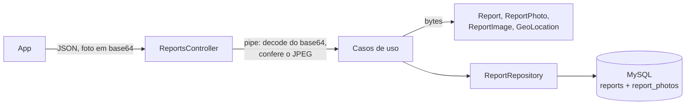
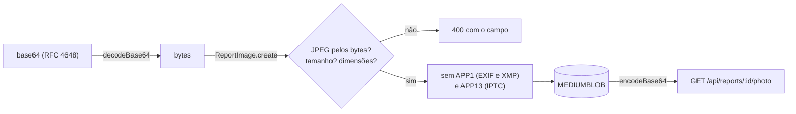

# Reportes

O cidadão abre um reporte de buraco no asfalto pelo app, com a foto e a localização do aparelho, e acompanha, edita e exclui os próprios reportes. Este documento explica como o módulo `reports` funciona por dentro: o caminho da foto, a localização, o envio repetido seguro, quem vê cada reporte e quem pode fazer o quê.

> Para consumir as rotas pelo app, veja a seção [Reportes do FRONTEND.md](FRONTEND.md#reportes). As decisões e as regras de negócio (RN26 a RN40) estão no [plano da sprint 4](sprints/sprint-4-reportes.md), e as requisições prontas, no [api.http](api.http).

## Sumário

- [Visão geral](#visão-geral)
- [Rotas e permissões](#rotas-e-permissões)
- [Abrir um reporte](#abrir-um-reporte)
- [A foto: do base64 aos bytes](#a-foto-do-base64-aos-bytes)
- [A localização](#a-localização)
- [Envio repetido seguro](#envio-repetido-seguro)
- [Visibilidade e ações de cada usuário](#visibilidade-e-ações-de-cada-usuário)
- [Editar e excluir](#editar-e-excluir)
- [Configuração](#configuração)
- [Erros](#erros)
- [Limitações conhecidas](#limitações-conhecidas)

## Visão geral

O módulo segue as camadas do [ARCHITECTURE.md](ARCHITECTURE.md) e fala com o módulo `users` só pelo `AuthenticatedUser` do guard, que traz o papel e o `emailVerified` (o guard já carrega o usuário a cada requisição).



| Peça                                                                                                            | Papel                                                                                                                                              |
| --------------------------------------------------------------------------------------------------------------- | -------------------------------------------------------------------------------------------------------------------------------------------------- |
| [`Report`](../src/modules/reports/domain/entities/report.entity.ts)                                             | As regras: nasce PENDING (`open`), a visibilidade (`isVisibleTo`), as ações (`canBeEditedBy`, `canBeDeletedBy`), `edit`, `replacePhoto` e `delete` |
| [`ReportPhoto`](../src/modules/reports/domain/entities/report-photo.entity.ts)                                  | A foto e a miniatura, com id próprio, que muda na troca da foto                                                                                    |
| [`ReportImage`](../src/modules/reports/domain/value-objects/report-image.ts)                                    | Uma imagem JPEG conferida pelos bytes, com as dimensões lidas do cabeçalho e sem os metadados                                                      |
| [`GeoPoint`, `GeoLocation`](../src/modules/reports/domain/value-objects/geo-location.ts) e `ReportArea`         | As coordenadas, a precisão (arredondada para cima), a distância por haversine e a área atendida                                                    |
| [`ReportRepository`](../src/modules/reports/domain/repositories/report.repository.ts) e `ReportPhotoRepository` | Os contratos. As implementações TypeORM ficam em `infra/database/repositories/`, com as funções espaciais                                          |
| [`base64.ts`](../src/shared/application/encoding/base64.ts)                                                     | `encodeBase64` e `decodeBase64` (estrito), compartilhados                                                                                          |
| [`OpenReportBodyPipe` e `EditReportBodyPipe`](../src/modules/reports/presentation/pipes/report-body.pipe.ts)    | Validam o corpo com os limites das imagens da configuração, no mesmo formato de erro do `ZodValidationPipe`                                        |

Os casos de uso recebem e devolvem os **bytes** da foto, nunca o base64: o transporte fica na apresentação, e o caso de uso não muda se o envio passar a ser multipart.

## Rotas e permissões

Todas as rotas ficam sob `/api/reports`, exigem a sessão e são só do **CLIENT** (`@Roles(Role.CLIENT)` no controller). ADMIN e SUPER_ADMIN recebem 403: a listagem para a prefeitura entra com o painel.

| Rota                         | SUPER_ADMIN | ADMIN | CLIENT | Sem sessão | Observação                                                        |
| ---------------------------- | :---------: | :---: | :----: | :--------: | ----------------------------------------------------------------- |
| `POST /api/reports`          |             |       |   ✔¹   |            | Abre o reporte. Header opcional `Idempotency-Key`                 |
| `GET /api/reports/mine`      |             |       |   ✔    |            | Os reportes do usuário, paginados, com o filtro `status`          |
| `GET /api/reports/nearby`    |             |       |   ✔    |            | Os reportes PENDING e CONFIRMED perto de um ponto                 |
| `GET /api/reports/:id`       |             |       |   ✔²   |            | O reporte                                                         |
| `GET /api/reports/:id/photo` |             |       |   ✔²   |            | A foto (`size=full`) ou a miniatura (`size=thumbnail`), em base64 |
| `PATCH /api/reports/:id`     |             |       |   ✔³   |            | A descrição e a foto                                              |
| `DELETE /api/reports/:id`    |             |       |   ✔⁴   |            | Exclusão lógica                                                   |

¹ Com o e-mail verificado (RN26). ² Os próprios reportes em qualquer status, e os de outros autores em PENDING ou CONFIRMED (RN35). ³ Só o autor, com o reporte em PENDING e sem votos (RN33). ⁴ Só o autor, com o reporte em PENDING (RN34).

As rotas também recusam a sessão pendente da segunda etapa do login (403 `invalid claim`), como todas as rotas protegidas ([AUTH.md](AUTH.md#o-que-o-authguard-faz-a-cada-requisição)). A matriz é testada rota a rota no [`permissions.e2e-spec.ts`](../test/permissions.e2e-spec.ts).

## Abrir um reporte

O `POST /api/reports` recebe a descrição opcional, a localização e a foto em base64:

```json
{
  "description": "Buraco grande na faixa da direita, perto do semáforo.",
  "location": { "latitude": -24.045812, "longitude": -52.378901, "accuracyMeters": 8.5 },
  "photo": {
    "content": "/9j/4AAQSkZJRgABAQAAAQABAAD...",
    "thumbnail": "/9j/4AAQSkZJRgABAQAAAQABAAD..."
  }
}
```

O pipe do corpo responde 400 com todos os campos inválidos de uma vez (a descrição longa, a coordenada fora da faixa, o base64 inválido, a imagem que não é JPEG ou que passa do tamanho e das dimensões). Com o corpo válido, o [`OpenReportUseCase`](../src/modules/reports/application/use-cases/open-report.use-case.ts) confere, nesta ordem:

1. **E-mail verificado** (RN26). Sem ele, 422 "Confirme o seu e-mail para abrir reportes.". O `emailVerified` vem do `AuthenticatedUser`: confirmado o e-mail, a mesma sessão já passa.
2. **`Idempotency-Key` já usada pelo autor** (RN31). A resposta é o reporte já criado, sem criar outro e sem contar no limite ([envio repetido seguro](#envio-repetido-seguro)).
3. **Precisão e área** (RN28). A precisão vem antes da área: com ela ruim, o ponto pode estar longe de onde o aparelho realmente está. Precisão pior que 50 m: 422 "A localização está imprecisa. Tente de novo num lugar aberto.". Fora da caixa da `REPORT_AREA_BOUNDS`: 422 "Este lugar fica fora de Campo Mourão.".
4. **Limite por dia** (RN30): 10 reportes em 24 horas, contando os excluídos, para a exclusão não liberar mais aberturas. No 11º, 422 "Você chegou ao limite de 10 reportes por dia.".

O reporte nasce PENDING ("Em validação"), com as contagens zeradas (RN32), e é gravado com a foto na mesma transação. A resposta é 201 com o reporte no formato da [seção 5 do plano](sprints/sprint-4-reportes.md#5-endpoints).

## A foto: do base64 aos bytes

A foto chega no JSON, em base64, no mesmo pedido dos outros dados, e é gravada em **binário**, numa tabela à parte (`report_photos`). O base64 ocuparia 33% a mais no disco e no backup, e a tabela à parte deixa as listagens sem ler as imagens.



- **O app trata a imagem.** O redimensionamento, a compressão e a orientação são feitos no aparelho, que envia a foto (maior lado de até 2048 px) e a miniatura (até 480 px). A API não reprocessa a imagem, então não precisa de biblioteca de imagem nem de CPU para isso.
- **Decode estrito.** O [`decodeBase64`](../src/shared/application/encoding/base64.ts) aceita só o alfabeto padrão, com o `=` do fim, sem quebra de linha e sem o prefixo `data:`. O `Buffer.from(text, 'base64')` do Node ignora os caracteres inválidos em silêncio, então o resultado é conferido codificando os bytes de novo.
- **Só JPEG, conferido pelos bytes.** O [`ReportImage`](../src/modules/reports/domain/value-objects/report-image.ts) confere a assinatura (`FF D8 FF` no início e `FF D9` no fim) e percorre os segmentos do cabeçalho até o início dos dados da imagem (SOS). O tipo que o cliente declara não importa. PNG, WebP, HEIC, um JPEG cortado e um arquivo qualquer são recusados.
- **Dimensões do cabeçalho.** A largura e a altura vêm do marcador SOF, no JPEG baseline e no progressivo. A foto passa de 2048 px no maior lado, ou a miniatura de 480 px: 400.
- **Tamanho.** A foto até 2 MB (`REPORT_PHOTO_MAX_BYTES`) e a miniatura até 100 KB (`REPORT_THUMBNAIL_MAX_BYTES`), contados nos bytes decodificados.
- **Metadados.** Os segmentos APP1 (EXIF e XMP) e APP13 (IPTC) saem, mesmo que o app já os tenha tirado: as fotos são vistas por outros cidadãos, e o EXIF pode ter o GPS e o modelo do aparelho. O APP0 (JFIF) e o APP2 (perfil de cor) ficam. Os dados comprimidos da imagem são copiados como estão, então ela continua abrindo igual. A remoção é feita sem biblioteca, só com a leitura dos segmentos.
- **Mensagens por imagem.** "A foto precisa ser uma imagem JPEG.", "A foto passa de 2 MB.", "A foto passa de 2048 px no maior lado." e as equivalentes para a miniatura, com o campo (`photo.content` ou `photo.thumbnail`) no `details`.

O schema [`base64JpegSchema`](../src/modules/reports/presentation/dtos/report-photo.dto.ts) faz o decode e chama o `ReportImage.create`, no espírito do `domainString`: a mensagem do erro de domínio vira a do campo, e o valor sai em bytes. O caso de uso cria o `ReportImage` de novo, e é ele que tira os metadados.

**Limite do corpo.** As rotas de `/api/reports` aceitam um corpo calculado a partir dos dois tamanhos máximos, em base64, com uma folga para o resto do corpo: com os padrões, cerca de 2,8 MB. As outras rotas continuam com 100 KB. O corpo maior responde 413 no formato de erro da aplicação ([ARCHITECTURE.md](ARCHITECTURE.md#limite-do-corpo-das-requisições)).

**Na leitura**, o `GET /api/reports/:id/photo` lê só a imagem pedida (as colunas das imagens usam `select: false`) e a devolve em base64, com o id da foto, que o app usa como chave do cache.

## A localização

A localização é uma coluna `POINT NOT NULL SRID 4326` (WGS 84, o sistema do GPS) com o índice espacial `sidx_reports_location`. O MySQL só usa o índice numa coluna `NOT NULL` e restrita a um SRID.

- **Ordem dos eixos.** No SRID 4326, o MySQL lê e escreve o WKT na ordem latitude-longitude, ao contrário do GeoJSON e da maioria das bibliotecas: o `ST_X()` devolve a latitude. Por isso o repositório grava com `ST_GeomFromText(?, 4326, 'axis-order=long-lat')` e lê com `ST_Latitude()` e `ST_Longitude()`, nunca com `ST_X()` e `ST_Y()`.
- **Distância.** No SRID 4326, o `ST_Distance()` responde em metros, no elipsoide do WGS 84. No domínio e nos fakes, a distância é calculada por haversine, na esfera: a diferença fica abaixo de 0,5%.
- **Reportes perto de um ponto.** O `findNearby` filtra antes por um retângulo em volta do ponto (`MBRContains`), que usa o índice espacial, e só depois pela distância exata. Com poucas linhas, o MySQL prefere ler a tabela inteira, que é mais barato. O teste de integração confere o plano com uma grade de 5 mil reportes: `EXPLAIN` com `type: range` e `key: sidx_reports_location`.
- **Precisão.** O aparelho informa a precisão em metros, que é arredondada para cima (8,5 vira 9) e precisa ser de até 50 m (`REPORT_MAX_ACCURACY_METERS`).
- **Área atendida.** A localização precisa estar dentro da caixa da `REPORT_AREA_BOUNDS`, uma caixa folgada em volta de Campo Mourão. Para testar fora da cidade, aumente a caixa no `.env` local.
- **A localização não muda** depois da abertura (RN28): o `PATCH` a ignora, e o repositório não a regrava.

## Envio repetido seguro

Em rede móvel, a resposta pode se perder depois de o reporte ser gravado. O app cria uma `Idempotency-Key` (UUID) quando a tela abre e a envia em todas as tentativas:

- com uma chave que o autor já usou, a resposta é o reporte já criado (201), sem criar outro e sem contar no limite por dia (RN31);
- a chave vale por autor (UNIQUE em `idempotency_key` + `author_id`): a de outro autor não interfere;
- a chave que não é UUID responde 400, com o `field` `Idempotency-Key`. Ela é guardada em minúsculas;
- **pedidos simultâneos.** Dois pedidos com a mesma chave passam juntos pela busca, mas só um grava: o outro esbarra no UNIQUE, e o caso de uso devolve o reporte do primeiro;
- se o autor excluiu o reporte da chave, a chave não abre outro: a resposta é 404, como em qualquer rota para o reporte excluído.

O header é lido pelo decorator [`@RequestHeader`](../src/shared/presentation/decorators/request-header.decorator.ts), que passa pelos pipes: o `@Headers()` do Nest não passa.

## Visibilidade e ações de cada usuário

| Quem vê            | PENDING | CONFIRMED | REJECTED | Excluído |
| ------------------ | :-----: | :-------: | :------: | :------: |
| O autor            |    ✔    |     ✔     |    ✔     |          |
| Os outros cidadãos |    ✔    |     ✔     |          |          |

O reporte que o usuário não pode ver responde **404**, igual ao que não existe, para não revelar que ele existe (RN35). As respostas nunca trazem o id, o nome ou o e-mail do autor: o `isMine` basta para o app.

Cada reporte das respostas traz o que o usuário da requisição pode fazer, calculado pela entidade: `canEdit` (o autor, com o reporte em PENDING e sem votos) e `canDelete` (o autor, com o reporte em PENDING). Os fronts mostram as ações a partir deles, sem repetir as regras.

## Editar e excluir

| Situação                                     | `PATCH /api/reports/:id`                                      | `DELETE /api/reports/:id`                            |
| -------------------------------------------- | ------------------------------------------------------------- | ---------------------------------------------------- |
| O autor, PENDING e sem votos                 | 200, com o reporte                                            | 204                                                  |
| O autor, PENDING e com votos                 | 422 "O reporte já recebeu votos e não pode mais ser editado." | 204                                                  |
| O autor, CONFIRMED ou REJECTED               | 422 "Só é possível editar um reporte em validação."           | 422 "Só é possível excluir um reporte em validação." |
| Outro cidadão que vê o reporte               | 403                                                           | 403                                                  |
| Quem não vê o reporte, ou o reporte excluído | 404                                                           | 404                                                  |

- O `PATCH` aceita a `description` e a `photo`, pelo menos uma. `""` (ou `null`) apaga a descrição. A foto nova substitui a anterior, com outro id, e passa pelas mesmas regras da abertura.
- A exclusão é lógica (`deleted_at`): o reporte some de todas as rotas, e os votos dele, que entram com a validação comunitária, ficam no banco. O reporte excluído continua contando no limite por dia.

## Configuração

Todas as variáveis têm valor padrão e são validadas pelo `envSchema`:

| Variável                        | Padrão                        | Uso                                                                                                                                      |
| ------------------------------- | ----------------------------- | ---------------------------------------------------------------------------------------------------------------------------------------- |
| `REPORT_AREA_BOUNDS`            | `-24.30,-52.65,-23.80,-52.11` | Área aceita: latitude mínima, longitude mínima, latitude máxima e longitude máxima. O mínimo de cada eixo precisa ser menor que o máximo |
| `REPORT_MAX_ACCURACY_METERS`    | `50`                          | Pior precisão aceita, em metros                                                                                                          |
| `REPORT_PHOTO_MAX_BYTES`        | `2097152`                     | Tamanho máximo da foto (2 MB), depois do decode                                                                                          |
| `REPORT_THUMBNAIL_MAX_BYTES`    | `102400`                      | Tamanho máximo da miniatura (100 KB)                                                                                                     |
| `REPORT_DAILY_LIMIT`            | `10`                          | Reportes por Client em 24 horas                                                                                                          |
| `REPORT_CONFIRMATIONS_REQUIRED` | `10`                          | Confirmações que tornam o reporte CONFIRMED. Já aparece na resposta (`votes.confirmationsRequired`)                                      |
| `REPORT_REJECTIONS_REQUIRED`    | `10`                          | Votos "não está lá" que tornam o reporte REJECTED                                                                                        |

As dimensões máximas das imagens (2048 e 480 px) são constantes do domínio. O limite do corpo das rotas de reportes é calculado a partir dos dois tamanhos máximos.

## Erros

| Status | Quando                                                                                                                                                                 |
| ------ | ---------------------------------------------------------------------------------------------------------------------------------------------------------------------- |
| 400    | Campo inválido: descrição longa, coordenada fora da faixa, base64 inválido, imagem que não é JPEG ou fora do tamanho e das dimensões, `Idempotency-Key` que não é UUID |
| 403    | ADMIN e SUPER_ADMIN, e o Client que tenta editar ou excluir o reporte de outro que ele vê                                                                              |
| 404    | Reporte que não existe, excluído ou que o usuário não pode ver (RN35)                                                                                                  |
| 413    | Corpo maior que o limite das rotas de reportes (cerca de 2,8 MB com os padrões)                                                                                        |
| 422    | E-mail não verificado, fora da área, precisão ruim, limite por dia, e edição ou exclusão fora da regra. A `message` diz o motivo                                       |

**Nada da foto, do base64 ou da localização vai para o log** (RN36), nem nas mensagens dos erros: as mensagens são fixas, inclusive a do JSON malformado, que no `JSON.parse` traria um trecho do corpo. O `DB_LOGGING=true` é a exceção: ele escreve no log as queries com os parâmetros, inclusive as coordenadas e as imagens, e por isso fica desligado fora da depuração local.

## Limitações conhecidas

- **Limite por dia sob concorrência.** O limite é conferido antes da gravação, sem trava: dois pedidos simultâneos do mesmo Client, com chaves diferentes, podem passar juntos do 10º reporte. O limite é uma barreira contra abuso, não uma garantia exata.
- **O UNIQUE da `Idempotency-Key` começa pela chave.** Com o índice na ordem (`author_id`, `idempotency_key`), o MySQL 9.7 o usa para a FK do autor e deixa de conferi-la nas linhas com a chave nula: um reporte sem a chave entrava com um `author_id` inexistente (comportamento reproduzido no MySQL do docker-compose). Com a chave na frente, a FK usa o índice (`author_id`, `created_at`), e o teste `database.integration-spec.ts` confere a recusa.
- **Busca perto dos polos e do antimeridiano.** Ali o retângulo da busca não é montado, e a consulta fica só com a distância, sem o índice. Os reportes ficam todos na área atendida, longe desses lugares.
- Os outros pontos (a foto no MySQL, a área como caixa, a localização falsa, o reporte que ninguém valida) estão nos [pontos em aberto do plano](sprints/sprint-4-reportes.md#10-pontos-em-aberto).
