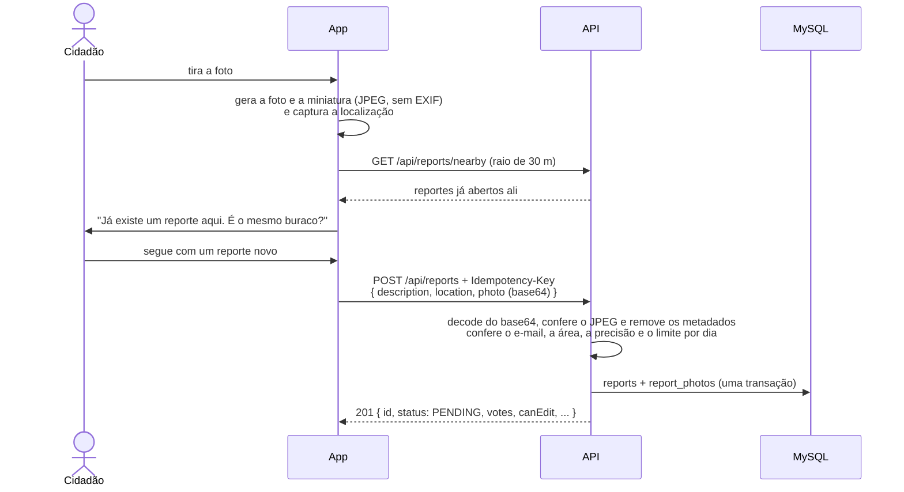
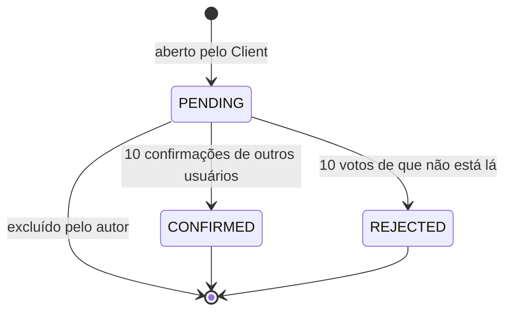
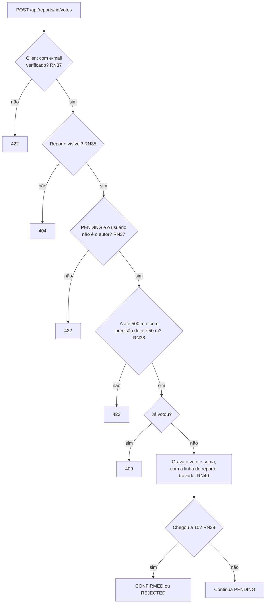
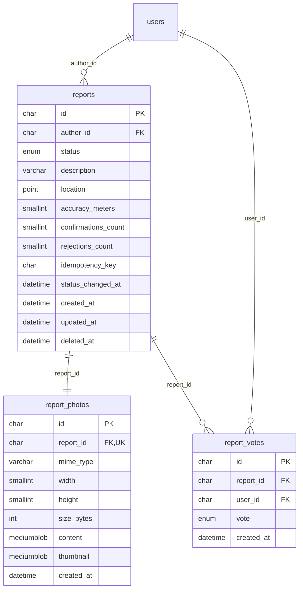
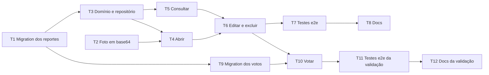

# Sprint 4 (26/10 - 04/11): reportes e validação comunitária

Plano do backend para o cidadão abrir um reporte de buraco no asfalto, com a foto e a localização do aparelho, e para os outros cidadãos validarem esse reporte, na mesma ideia dos apps de mobilidade (Waze e Google Maps): quando 10 outros usuários confirmam que o buraco está lá, o reporte passa a ser considerado verdadeiro.

Este plano continua os das [sprints 2](sprint-2-usuarios.md) e [3](sprint-3-login.md). As decisões e as regras RN01 a RN25 seguem valendo, e as regras novas continuam a numeração (RN26 a RN40).

São dois epics: a **criação dos reportes** e a **validação comunitária**. A validação depende da criação e é o bloco que pode passar para a sprint seguinte sem travar o app.

## 1. Decisões

| Tema                       | Decisão                                                                                                                                                                                                                                                                                                                          |
| -------------------------- | -------------------------------------------------------------------------------------------------------------------------------------------------------------------------------------------------------------------------------------------------------------------------------------------------------------------------------- |
| Módulo                     | `reports`, novo, com as camadas do [ARCHITECTURE.md](../ARCHITECTURE.md). Ele fala com o módulo `users` só pelo `AuthenticatedUser` do guard, que ganha o campo `emailVerified` (o guard já carrega o usuário a cada requisição).                                                                                                |
| Foto no transporte         | JSON, com a foto em **base64**, no mesmo `POST /api/reports` dos outros dados. Um pedido só cria o reporte inteiro, sem multipart, e passa pelo `ZodValidationPipe` como as outras rotas. O app envia e recebe a foto em base64.                                                                                                 |
| Foto no banco              | **Binário** (`MEDIUMBLOB`), numa tabela à parte (`report_photos`). O base64 ocupa 33% a mais no disco e no backup, e a tabela à parte deixa as listagens sem ler as imagens. O **decode** acontece na entrada e o **encode** na saída, em funções de `shared/application/encoding/`.                                             |
| Tratamento da imagem       | O redimensionamento, a compressão e a orientação são feitos **no app**, que envia a foto (maior lado de até 2048 px) e a miniatura (até 480 px). A API não reprocessa a imagem, então não precisa do `sharp` (libvips) nem de CPU para isso. Ela confere o formato pelos bytes, o tamanho e as dimensões, e remove os metadados. |
| Metadados                  | A API remove o EXIF e o XMP da foto antes de gravar, mesmo que o app já tenha removido. As fotos são vistas por outros cidadãos, e o EXIF pode ter o GPS e o modelo do aparelho. A remoção é feita sem biblioteca, só com a leitura dos segmentos do JPEG.                                                                       |
| Formato                    | Só **JPEG**. O app sempre gera JPEG, e um formato só simplifica a leitura das dimensões e a remoção dos metadados.                                                                                                                                                                                                               |
| Localização                | Coluna `POINT` com **SRID 4326** (WGS 84, o sistema do GPS) e **índice espacial**. As consultas de proximidade (reportes perto de um ponto) usam o índice, e a distância em metros é calculada pelo MySQL.                                                                                                                       |
| Área atendida              | Só entram reportes dentro de uma caixa em volta de Campo Mourão, configurável (`REPORT_AREA_BOUNDS`).                                                                                                                                                                                                                            |
| Ligação com o usuário      | `reports.author_id` → `users.id`. O autor vê os próprios reportes, e os outros cidadãos nunca veem quem abriu um reporte.                                                                                                                                                                                                        |
| Validação                  | Um voto por usuário e reporte, em `report_votes`. As contagens ficam também em `reports` (desnormalizadas), atualizadas na mesma transação que grava o voto, com a linha do reporte travada (`SELECT ... FOR UPDATE`). A regra da mudança de status fica na entidade `Report`.                                                   |
| Antifraude da validação    | Só vota o Client com o e-mail verificado, uma vez por reporte, fora do próprio reporte e perto dele. A localização de quem vota é conferida e descartada.                                                                                                                                                                        |
| E-mail verificado          | Exigido para abrir e para validar reportes. Resolve o ponto em aberto da sprint 3: sem essa barreira, contas descartáveis bastariam para confirmar um reporte falso.                                                                                                                                                             |
| O que o usuário pode fazer | As respostas trazem `canEdit` e `canDelete` (e `canVote`, no epic 2), calculados pela entidade para o usuário da requisição. Os fronts mostram as ações a partir deles e não repetem as regras.                                                                                                                                  |
| Envio repetido             | O `POST /api/reports` aceita o header `Idempotency-Key`. Em rede móvel, a resposta pode se perder depois de o reporte ser gravado: o app repete com a mesma chave e recebe o mesmo reporte, sem criar outro.                                                                                                                     |
| Painel da prefeitura       | Fora deste plano. As rotas novas são do Client. A listagem para a prefeitura, o mapa, o status do atendimento e o dashboard entram no épico do painel.                                                                                                                                                                           |
| Demais padrões             | Os das sprints anteriores: validação com Zod, erros de domínio por categoria, paginação `{ items, page, pageSize, total }`, fakes em memória nos testes unitários e o MySQL de teste nos de integração e e2e.                                                                                                                    |

## 2. Fluxos

### Abrir um reporte



### Ciclo de vida do reporte



`PENDING` aparece no app como "Em validação". Os status do atendimento pela prefeitura (em andamento, resolvido) entram com o painel, depois de `CONFIRMED`.

### Votar (epic 2)



## 3. Modelagem (MySQL)

A tabela `users` não muda. As tabelas novas ficam no módulo `reports`.



### `reports` (nova, epic 1)

| Coluna                     | Tipo                                     | Restrições                         | Observação                                                                                         |
| -------------------------- | ---------------------------------------- | ---------------------------------- | -------------------------------------------------------------------------------------------------- |
| `id`                       | `CHAR(36)`                               | PK                                 |                                                                                                    |
| `author_id`                | `CHAR(36)`                               | FK `users.id` (RESTRICT), NOT NULL | Índice (`author_id`, `created_at`), para "meus reportes" e o limite por dia                        |
| `status`                   | `ENUM('PENDING','CONFIRMED','REJECTED')` | NOT NULL, default `PENDING`        | Os status do atendimento entram com o painel, por migration                                        |
| `description`              | `VARCHAR(500)`                           | NULL                               | Com `trim`. Vazia vira NULL                                                                        |
| `location`                 | `POINT SRID 4326`                        | NOT NULL                           | Índice espacial `sidx_reports_location`. O MySQL exige a coluna NOT NULL e com o SRID para indexar |
| `accuracy_meters`          | `SMALLINT UNSIGNED`                      | NOT NULL                           | Precisão informada pelo aparelho, arredondada para cima                                            |
| `confirmations_count`      | `SMALLINT UNSIGNED`                      | NOT NULL, default 0                | Cópia da contagem de `report_votes` (epic 2)                                                       |
| `rejections_count`         | `SMALLINT UNSIGNED`                      | NOT NULL, default 0                | Idem                                                                                               |
| `idempotency_key`          | `CHAR(36)`                               | NULL                               | UNIQUE (`author_id`, `idempotency_key`): a chave vale por autor                                    |
| `status_changed_at`        | `DATETIME(3)`                            | NULL                               | Quando o reporte saiu de `PENDING`                                                                 |
| `created_at`, `updated_at` | `DATETIME(3)`                            | NOT NULL                           | `BaseOrmEntity`                                                                                    |
| `deleted_at`               | `DATETIME(3)`                            | NULL                               | Exclusão lógica pelo autor (`@DeleteDateColumn`)                                                   |

### `report_photos` (nova, epic 1)

| Coluna       | Tipo                | Restrições                        | Observação                                                               |
| ------------ | ------------------- | --------------------------------- | ------------------------------------------------------------------------ |
| `id`         | `CHAR(36)`          | PK                                | Muda quando a foto é trocada: o app usa o id como chave do cache         |
| `report_id`  | `CHAR(36)`          | FK `reports.id` (CASCADE), UNIQUE | Uma foto por reporte, por enquanto                                       |
| `mime_type`  | `VARCHAR(30)`       | NOT NULL                          | `image/jpeg`                                                             |
| `width`      | `SMALLINT UNSIGNED` | NOT NULL                          | Da foto, lida do cabeçalho do JPEG. A miniatura tem a mesma proporção    |
| `height`     | `SMALLINT UNSIGNED` | NOT NULL                          | Idem                                                                     |
| `size_bytes` | `INT UNSIGNED`      | NOT NULL                          | Da foto, depois da remoção dos metadados                                 |
| `content`    | `MEDIUMBLOB`        | NOT NULL                          | A foto. O tipo aceita até 16 MB, e a regra limita a 2 MB                 |
| `thumbnail`  | `MEDIUMBLOB`        | NOT NULL                          | A miniatura, até 100 KB (passa dos 64 KB do `BLOB`)                      |
| `created_at` | `DATETIME(3)`       | NOT NULL                          | Sem `updated_at`: a foto não muda, é substituída por outra, com outro id |

A entidade ORM não estende a `BaseOrmEntity`, como a `login_attempts`. As colunas `content` e `thumbnail` usam `select: false`, para nenhuma consulta trazer as imagens sem pedir.

### `report_votes` (nova, epic 2)

| Coluna       | Tipo                     | Restrições                       | Observação                          |
| ------------ | ------------------------ | -------------------------------- | ----------------------------------- |
| `id`         | `CHAR(36)`               | PK                               |                                     |
| `report_id`  | `CHAR(36)`               | FK `reports.id` (CASCADE)        | UNIQUE (`report_id`, `user_id`)     |
| `user_id`    | `CHAR(36)`               | FK `users.id` (RESTRICT), índice |                                     |
| `vote`       | `ENUM('CONFIRM','DENY')` | NOT NULL                         | "O buraco está lá" ou "não está lá" |
| `created_at` | `DATETIME(3)`            | NOT NULL                         | Sem `updated_at`: o voto não muda   |

> A localização de quem vota não é gravada (RN38). Ela só serve para conferir a distância até o reporte, e guardá-la registraria por onde cada cidadão passa.

### Cuidados com a coluna espacial

- **Ordem dos eixos.** No SRID 4326, o MySQL lê e escreve o WKT na ordem latitude-longitude, ao contrário do GeoJSON e da maioria das bibliotecas. Escreva com `ST_GeomFromText(?, 4326, 'axis-order=long-lat')` e leia com `ST_Latitude()` e `ST_Longitude()`, nunca com `ST_X()` e `ST_Y()`.
- **Distância em metros.** No SRID 4326, o `ST_Distance()` entre dois pontos já responde em metros, pelo elipsoide. Para a consulta usar o índice espacial, ela filtra antes por um retângulo em volta do ponto (`MBRContains`) e só depois pela distância. Confira com o `EXPLAIN`.
- **TypeORM.** As expressões acima ficam no repositório, pelo QueryBuilder. Revise o SQL do `migration:generate`, que pode errar o SRID ou o índice espacial.
- **Exclusão da conta (RN11).** A linha de `users` nunca é apagada, então os reportes e os votos continuam ligados à conta anonimizada. Nenhum dado pessoal fica nas tabelas novas.

## 4. Regras de negócio

| Código | Regra                                                                                                                                                                                                                                                                                                                        |
| ------ | ---------------------------------------------------------------------------------------------------------------------------------------------------------------------------------------------------------------------------------------------------------------------------------------------------------------------------- |
| RN26   | Só o CLIENT ACTIVE com o e-mail verificado abre reportes. ADMIN e SUPER_ADMIN não abrem.                                                                                                                                                                                                                                     |
| RN27   | O reporte tem uma foto e a localização do aparelho, obrigatórias, e uma descrição opcional de até 500 caracteres.                                                                                                                                                                                                            |
| RN28   | A localização precisa estar dentro da área de Campo Mourão (`REPORT_AREA_BOUNDS`) e ter precisão de até 50 metros (`REPORT_MAX_ACCURACY_METERS`). Ela não muda depois de o reporte ser aberto.                                                                                                                               |
| RN29   | A foto chega em base64, em duas versões geradas pelo app: a foto (JPEG, até 2 MB e até 2048 px no maior lado) e a miniatura (JPEG, até 100 KB e até 480 px). A API confere o formato pelos bytes, e não pelo que o cliente declara, lê as dimensões do cabeçalho, remove os metadados (EXIF, XMP e IPTC) e grava em binário. |
| RN30   | Cada Client abre no máximo 10 reportes em 24 horas (`REPORT_DAILY_LIMIT`). Os reportes excluídos também contam.                                                                                                                                                                                                              |
| RN31   | Um pedido de abertura com uma `Idempotency-Key` que o mesmo autor já usou não cria outro reporte: a resposta traz o reporte já criado, e ele não conta de novo no limite por dia.                                                                                                                                            |
| RN32   | Todo reporte nasce `PENDING` (em validação), com as contagens zeradas.                                                                                                                                                                                                                                                       |
| RN33   | Só o autor edita o reporte, só enquanto ele está `PENDING` e sem nenhum voto, e só a descrição e a foto. A foto nova substitui a anterior, com outro id.                                                                                                                                                                     |
| RN34   | Só o autor exclui o reporte, só enquanto ele está `PENDING`. A exclusão é lógica: o reporte some de todas as rotas, e os votos dele ficam no banco.                                                                                                                                                                          |
| RN35   | O Client vê os próprios reportes em qualquer status, e os de outros autores só em `PENDING` ou `CONFIRMED`, sem nenhum dado do autor. Os demais casos respondem 404, para não revelar que o reporte existe.                                                                                                                  |
| RN36   | A foto, a localização e o base64 nunca vão para o log, nem na mensagem de um erro.                                                                                                                                                                                                                                           |
| RN37   | Só o CLIENT ACTIVE com o e-mail verificado vota, num reporte `PENDING` que não é dele, uma vez por reporte: "está lá" (`CONFIRM`) ou "não está lá" (`DENY`). O voto não muda depois de dado.                                                                                                                                 |
| RN38   | Quem vota envia a localização atual, que precisa estar a até 500 metros do reporte (`REPORT_VOTE_MAX_DISTANCE_METERS`) e ter a precisão da RN28. Essa localização não é gravada.                                                                                                                                             |
| RN39   | Com 10 confirmações (`REPORT_CONFIRMATIONS_REQUIRED`), o reporte vira `CONFIRMED`. Com 10 votos "não está lá" (`REPORT_REJECTIONS_REQUIRED`), vira `REJECTED`. Vale o que chegar primeiro. A mudança é definitiva, grava o `status_changed_at`, e os votos seguintes são recusados. O autor não conta como confirmação.      |
| RN40   | Votos simultâneos no mesmo reporte são contados um a um: nenhum se perde, e a mudança de status acontece uma vez só.                                                                                                                                                                                                         |

### Matriz de permissões (rotas novas)

| Ação                                 | SUPER_ADMIN | ADMIN | CLIENT | Público |
| ------------------------------------ | :---------: | :---: | :----: | :-----: |
| Abrir um reporte                     |             |       |   ✔¹   |         |
| Listar os próprios reportes          |             |       |   ✔    |         |
| Ver um reporte e a foto dele         |             |       |   ✔²   |         |
| Listar os reportes perto de um ponto |             |       |   ✔    |         |
| Editar e excluir o próprio reporte   |             |       |   ✔³   |         |
| Votar num reporte (epic 2)           |             |       |  ✔¹ ⁴  |         |

¹ Com o e-mail verificado. ² Os próprios, em qualquer status, e os de outros, em `PENDING` ou `CONFIRMED`. ³ Em `PENDING`, e a edição também sem votos. ⁴ Não no próprio reporte, e a até 500 m dele.

## 5. Endpoints

Todos ficam sob `/api` e exigem a sessão.

| Método   | Rota                 | Acesso         | Descrição                                                                                                                                                     |
| -------- | -------------------- | -------------- | ------------------------------------------------------------------------------------------------------------------------------------------------------------- |
| `POST`   | `/reports`           | CLIENT¹        | Abre o reporte. Header opcional `Idempotency-Key` (UUID). Responde 201                                                                                        |
| `GET`    | `/reports/mine`      | CLIENT         | Os reportes do usuário, do mais novo ao mais antigo, paginados. Filtro `status`                                                                               |
| `GET`    | `/reports/nearby`    | CLIENT         | `?latitude&longitude&radiusMeters`: os reportes `PENDING` e `CONFIRMED` a até `radiusMeters` (padrão 1000, de 10 a 5000), do mais perto ao mais longe, até 50 |
| `GET`    | `/reports/:id`       | CLIENT²        | O reporte                                                                                                                                                     |
| `GET`    | `/reports/:id/photo` | CLIENT²        | `?size=full\|thumbnail` (padrão `full`): `{ id, mimeType, content }`, com o `content` em base64                                                               |
| `PATCH`  | `/reports/:id`       | CLIENT, autor³ | `{ description?, photo? }`, pelo menos um. Responde o reporte                                                                                                 |
| `DELETE` | `/reports/:id`       | CLIENT, autor³ | Exclusão lógica. Responde 204                                                                                                                                 |
| `POST`   | `/reports/:id/votes` | CLIENT¹ ⁴      | Epic 2. `{ vote, location }`. Responde 201 com o reporte atualizado                                                                                           |

As notas são as da [matriz de permissões](#matriz-de-permissões-rotas-novas). Nenhuma rota existente muda: o `emailVerified` do `AuthenticatedUser` é interno.

**Corpo do `POST /api/reports`:**

```json
{
  "description": "Buraco grande na faixa da direita, perto do semáforo.",
  "location": { "latitude": -24.045812, "longitude": -52.378901, "accuracyMeters": 8.5 },
  "photo": {
    "content": "/9j/4AAQSkZJRgABAQAAAQABAAD...",
    "thumbnail": "/9j/4AAQSkZJRgABAQAAAQABAAD..."
  }
}
```

O base64 é o padrão (RFC 4648), com o `=` do fim e sem o prefixo `data:image/jpeg;base64,`. O `PATCH` aceita o mesmo `photo` e a `description` (`""` apaga a descrição).

**Reporte (resposta do `POST`, do `PATCH`, do detalhe e dos itens das listas):**

```json
{
  "id": "8f0e2c4a-6b1d-4c7e-9a52-3d6f1e0b7a91",
  "status": "PENDING",
  "description": "Buraco grande na faixa da direita, perto do semáforo.",
  "location": { "latitude": -24.045812, "longitude": -52.378901, "accuracyMeters": 9 },
  "photo": { "id": "c1b7d0e2-2f4a-4b8e-9d61-5a3c7e8f9b10", "width": 1600, "height": 1200 },
  "votes": {
    "confirmations": 3,
    "rejections": 0,
    "confirmationsRequired": 10,
    "rejectionsRequired": 10
  },
  "isMine": true,
  "canEdit": false,
  "canDelete": true,
  "createdAt": "2026-11-09T14:30:00.000Z",
  "updatedAt": "2026-11-09T14:30:00.000Z",
  "statusChangedAt": null
}
```

- No `GET /api/reports/nearby`, cada item tem também o `distanceMeters` (inteiro).
- No epic 2, o `votes` ganha o `mine` (`"CONFIRM"`, `"DENY"` ou `null`), e o reporte ganha o `canVote`.
- A resposta nunca traz o id, o nome ou o e-mail do autor: o `isMine` basta para o app.

**Corpo do `POST /api/reports/:id/votes` (epic 2):**

```json
{
  "vote": "CONFIRM",
  "location": { "latitude": -24.045903, "longitude": -52.378766, "accuracyMeters": 12 }
}
```

**Erros:**

| Status | Quando                                                                                                                                                                                |
| ------ | ------------------------------------------------------------------------------------------------------------------------------------------------------------------------------------- |
| 400    | Campo inválido: descrição longa, coordenada fora da faixa, base64 inválido, imagem que não é JPEG ou fora do tamanho e das dimensões. O `details` traz o campo (ex.: `photo.content`) |
| 403    | ADMIN e SUPER_ADMIN, e o Client que tenta editar ou excluir o reporte de outro que ele pode ver                                                                                       |
| 404    | Reporte que não existe, excluído ou que o usuário não pode ver (RN35)                                                                                                                 |
| 409    | Voto repetido (epic 2)                                                                                                                                                                |
| 413    | Corpo maior que o limite das rotas de reportes                                                                                                                                        |
| 422    | E-mail não verificado, fora da área, precisão ruim, limite por dia, edição ou exclusão fora da regra, e o voto fora da regra (epic 2). A `message` diz o motivo                       |

## 6. Variáveis de ambiente

**API (`envSchema` e `.env.example`).** Todas têm valor padrão:

| Variável                          | Padrão                        | Uso                                                                                                                        |
| --------------------------------- | ----------------------------- | -------------------------------------------------------------------------------------------------------------------------- |
| `REPORT_AREA_BOUNDS`              | `-24.30,-52.65,-23.80,-52.11` | Área aceita: latitude mínima, longitude mínima, latitude máxima e longitude máxima. Caixa folgada em volta de Campo Mourão |
| `REPORT_MAX_ACCURACY_METERS`      | `50`                          | Pior precisão aceita, na abertura e no voto                                                                                |
| `REPORT_PHOTO_MAX_BYTES`          | `2097152`                     | Tamanho máximo da foto (2 MB), depois do decode                                                                            |
| `REPORT_THUMBNAIL_MAX_BYTES`      | `102400`                      | Tamanho máximo da miniatura (100 KB)                                                                                       |
| `REPORT_DAILY_LIMIT`              | `10`                          | Reportes por Client em 24 horas                                                                                            |
| `REPORT_CONFIRMATIONS_REQUIRED`   | `10`                          | Confirmações que tornam o reporte `CONFIRMED`                                                                              |
| `REPORT_REJECTIONS_REQUIRED`      | `10`                          | Votos "não está lá" que tornam o reporte `REJECTED`                                                                        |
| `REPORT_VOTE_MAX_DISTANCE_METERS` | `500`                         | Distância máxima entre quem vota e o reporte (epic 2)                                                                      |

As dimensões máximas das imagens (2048 e 480 px) são constantes do domínio, e o limite do corpo das rotas de reportes é calculado a partir dos dois tamanhos máximos (≈ 3 MB com os padrões). No `.env.test`, as duas contagens da validação ficam em `3`, para os e2e criarem menos contas. Para testar fora de Campo Mourão, aumente a `REPORT_AREA_BOUNDS` do `.env` local.

**SuperTokens Core:** nenhuma variável muda.

## 7. Labels

Crie a label **`Sprint 4 - 26/10 - 04/11`** (as labels `Epic` e `Task` já existem). Os dois epics recebem `Epic` + a label da sprint, e cada task recebe `Task` + a label da sprint. Se o epic da validação passar para a sprint seguinte, troque a label só dele e das tasks T9 a T12.

## 8. Ordem e dependências



T1 e T2 não dependem de nada e podem começar em paralelo.

O contrato da [seção 5](#5-endpoints) vale desde já: o app começa as telas com os fakes, sem esperar a API. Para o app testar de verdade, o mínimo é a T4 e a T5.

---

## 9. Issues

### EPIC 1

**Título:** `[EPIC] Reportes de buracos: criação com foto e localização`
**Labels:** `Epic`, `Sprint 4 - 26/10 - 04/11`

```markdown
O cidadão abre um reporte de buraco no asfalto pelo app, com a foto e a localização do aparelho, e acompanha, edita e exclui os próprios reportes. É a primeira entrega do domínio principal do ReportaAi Cm e a base da validação comunitária e do painel da prefeitura.

- **Abrir**: o Client com o e-mail verificado envia a foto, em base64, e a localização. A API confere a imagem, a área e a precisão, e guarda a foto em binário.
- **Acompanhar**: o Client lista os próprios reportes, com o status e as contagens da validação, e consulta os reportes já abertos perto de um ponto, para não abrir um repetido.
- **Corrigir**: o autor troca a foto e a descrição enquanto ninguém votou, e exclui o reporte enquanto ele está em validação.

### Escopo

- Módulo `reports`, com as tabelas `reports` e `report_photos`
- Encode e decode da foto em base64, com a validação do JPEG e a remoção dos metadados
- Abertura do reporte, com o limite por dia e o envio repetido seguro (`Idempotency-Key`)
- Listagem dos próprios reportes, detalhe, foto e reportes perto de um ponto
- Edição e exclusão pelo autor
- E-mail verificado obrigatório para abrir reportes (ponto em aberto da sprint 3)

### Fora do escopo

Votos (epic da validação), rotas do painel (listagem, mapa, status do atendimento e dashboard), endereço por geocodificação reversa, mais de uma foto por reporte, notificações e armazenamento de objetos (S3).

### Definição de pronto (vale para todas as tasks)

- Testes unitários dos casos de uso e das regras de domínio, com cobertura ≥ 90% em `modules/reports/domain`, conferida no `npm run test:cov`
- `npm run lint`, `npm run typecheck` e `npm test` passando
- Migrations com `down` implementado
- Rota nova incluída na matriz do `permissions.e2e-spec.ts`
- Nenhuma imagem, base64 ou coordenada em log (RN36)
- Documentação atualizada quando a task mudar env, schema ou rotas

### Tasks

- [ ] T1 [DB] Migration das tabelas de reportes e fotos
- [ ] T2 [FEAT] Encode e decode da foto em base64 e validação do JPEG
- [ ] T3 [FEAT] Domínio e repositório dos reportes
- [ ] T4 [FEAT] Abrir um reporte
- [ ] T5 [FEAT] Consultar os reportes: os meus, o detalhe, a foto e os de perto
- [ ] T6 [FEAT] Editar e excluir o próprio reporte
- [ ] T7 [TEST] Testes e2e dos reportes
- [ ] T8 [DOCS] Documentar os reportes
```

> Depois de criar as tasks, troque cada `T<n>` pelo número da issue, para o GitHub linkar automaticamente, ou adicione as tasks como sub-issues do epic.

---

### T1

**Título:** `[DB] Migration das tabelas de reportes e fotos`

```markdown
Criar as tabelas `reports` e `report_photos` (`docs/sprints/sprint-4-reportes.md`, seção 3), numa migration só.

- `reports`, com a coluna `location POINT NOT NULL SRID 4326`, o índice espacial `sidx_reports_location`, o índice (`author_id`, `created_at`) e o UNIQUE (`author_id`, `idempotency_key`)
- FK `reports.author_id` → `users.id` com `RESTRICT`: os usuários não são apagados fisicamente (RN11)
- `report_photos`, com `content` e `thumbnail` em `MEDIUMBLOB`, e o UNIQUE em `report_id` (FK com `ON DELETE CASCADE`)
- Nomes explícitos de índices e constraints, no padrão `uq_`, `idx_` e `fk_` (e `sidx_` para o espacial)
- Módulo `ReportsModule`, importado no `AppModule`, com as entidades `ReportOrmEntity` e `ReportPhotoOrmEntity` registradas com `TypeOrmModule.forFeature`. A `ReportPhotoOrmEntity` não estende a `BaseOrmEntity`, e as colunas das imagens usam `select: false`
- Atualizar o diagrama ER e a tabela de `docs/DATABASE.md`, com os cuidados da coluna espacial

**Critérios de aceite**

- `migration:run` e `migration:revert` funcionam num banco limpo e num banco com usuários
- Depois da migration, o `migration:generate` não propõe diferenças. Se o TypeORM insistir no SRID ou no índice espacial, registre no PR o que foi feito
- `SHOW CREATE TABLE reports` mostra o `SRID 4326` na coluna e o `SPATIAL KEY`
- Teste de integração: gravar um reporte com a foto e ler de volta a latitude, a longitude e os bytes das imagens, iguais aos gravados
```

### T2

**Título:** `[FEAT] Encode e decode da foto em base64 e validação do JPEG`

```markdown
Criar as funções que convertem a foto entre o base64 do JSON e os bytes gravados, e as regras da imagem (RN29). Não cria rota: é a base da T4 e da T6.

- `shared/application/encoding/base64.ts`: `encodeBase64(bytes)` e `decodeBase64(text)`. O decode é estrito (RFC 4648, com o `=` do fim, sem quebra de linha e sem o prefixo `data:`) e recusa o texto inválido. O `Buffer.from(text, 'base64')` do Node ignora os caracteres inválidos em silêncio, então não serve sozinho
- Value object `ReportImage`, em `modules/reports/domain/value-objects/`, só com `Uint8Array` (o domínio continua sem o `Buffer` do Node): `ReportImage.create(bytes, { maxBytes, maxDimension })` confere a assinatura do JPEG (`FF D8 FF` no início e `FF D9` no fim), lê a largura e a altura do marcador SOF e remove os segmentos APP1 (EXIF e XMP) e APP13 (IPTC). O APP0 (JFIF) e o APP2 (perfil de cor) ficam
- A API não gira a imagem: o app envia os pixels já na orientação certa, sem depender da orientação do EXIF
- Erros de domínio com as mensagens em português, por imagem: "A foto precisa ser uma imagem JPEG.", "A foto passa de 2 MB.", "A foto passa de 2048 px no maior lado.", e o equivalente para a miniatura
- Schema Zod `base64JpegSchema({ maxBytes, maxDimension })`, no espírito do `domainString`: o 400 sai com o campo (`photo.content` ou `photo.thumbnail`) e a mensagem do domínio
- Limite do corpo: o parser de JSON das rotas `/api/reports` aceita o tamanho calculado a partir dos dois limites das imagens, com a folga do base64 (≈ 3 MB), e as outras rotas continuam com o padrão de 100 KB. O `main.ts` e o `E2eApp` criam a aplicação com `bodyParser: false`, e o `configureApp` registra os dois parsers
- O 413 do corpo grande sai no formato de erro da aplicação. O erro do parser não passa sozinho pelo `GlobalExceptionFilter`
- Variáveis `REPORT_PHOTO_MAX_BYTES` (2097152) e `REPORT_THUMBNAIL_MAX_BYTES` (102400). As dimensões máximas (2048 e 480 px) são constantes do domínio

**Critérios de aceite**

- `decodeBase64(encodeBase64(bytes))` devolve os mesmos bytes, e um texto com caractere inválido, sem o `=` do fim ou com o prefixo `data:` é recusado
- PNG, WebP, HEIC, um JPEG cortado e um arquivo qualquer com outro conteúdo são recusados com 400
- Um JPEG com EXIF com GPS (fixture em `test/fixtures/`) sai sem os segmentos de metadados e continua abrindo como imagem
- As dimensões lidas batem com as da imagem, num JPEG baseline e num progressivo
- Um corpo de 4 MB em `/api/reports` responde 413, e um corpo de 200 KB numa rota de usuários continua respondendo 413
- O base64 não aparece no log nem na mensagem de nenhum erro
```

### T3

**Título:** `[FEAT] Domínio e repositório dos reportes`

```markdown
Criar o domínio dos reportes e a persistência, sem rota. As regras ficam na entidade, e as consultas espaciais, no repositório.

- Entidade `Report`, com `Report.open(...)` (valida, nasce `PENDING`) e `Report.restore(...)`. Métodos com nome de negócio: `edit(...)`, `replacePhoto(...)` e `delete()`, e as consultas `canBeEditedBy(userId)` e `canBeDeletedBy(userId)` (RN33 e RN34)
- Value objects `GeoLocation` (latitude de -90 a 90, longitude de -180 a 180, precisão em metros arredondada para cima e `distanceTo(other)` em metros, por haversine) e `ReportDescription` (até 500 caracteres, com `trim`; vazia vira nula)
- `ReportArea`, com a caixa da `REPORT_AREA_BOUNDS` e a precisão máxima da `REPORT_MAX_ACCURACY_METERS`, conferidas na abertura (RN28)
- Entidade `ReportPhoto`, com o id próprio, as dimensões e as duas `ReportImage` da T2
- Contrato `ReportRepository`: `create(report, photo)` (as duas tabelas numa transação), `save(report, photo?)` (a foto nova substitui a anterior), `findById`, `findByIdempotencyKey(authorId, key)`, `findByAuthor(authorId, page, filtros)`, `findNearby(point, radiusMeters, limit)` (com a distância, do mais perto ao mais longe), `countCreatedSince(authorId, since)` (contando os excluídos) e `softDelete(report)`
- Contrato `ReportPhotoRepository.findContent(reportId, size)`, que lê só a imagem pedida
- Implementações TypeORM e mappers, com as funções espaciais dos "Cuidados com a coluna espacial" do plano
- `AuthenticatedUser` ganha o `emailVerified`, preenchido pelo `GetAuthenticatedUserUseCase`, que já carrega o usuário
- Fakes em memória em `modules/reports/testing/`, com a distância por haversine
- Variáveis `REPORT_AREA_BOUNDS` e `REPORT_MAX_ACCURACY_METERS` no `envSchema`, com a caixa validada (o mínimo menor que o máximo)

**Critérios de aceite**

- A cobertura de `modules/reports/domain` fica ≥ 90%, e o limite entra no `test:cov`
- Teste de integração do `findNearby`: de três pontos a 10 m, 400 m e 2 km, o raio de 500 m traz os dois primeiros, nessa ordem, com a distância certa (±1 m)
- O `EXPLAIN` do `findNearby` mostra o índice espacial (cole a saída no PR)
- Teste de integração: a latitude e a longitude voltam iguais às gravadas, sem trocar a ordem dos eixos
- O `findByAuthor` e o `findNearby` não leem as colunas das imagens
```

### T4

**Título:** `[FEAT] Abrir um reporte`

```markdown
`POST /api/reports` (CLIENT), com a foto em base64 e a localização (RN26 a RN32).

- Corpo `{ description?, location: { latitude, longitude, accuracyMeters }, photo: { content, thumbnail } }`, validado com Zod e o `base64JpegSchema` da T2
- Caso de uso `OpenReportUseCase`, que recebe os bytes, e não o base64: o transporte fica na `presentation`, e o caso de uso não muda se o envio passar a ser multipart
- Recusas com 422: e-mail não verificado ("Confirme o seu e-mail para abrir reportes."), fora da área ("Este lugar fica fora de Campo Mourão."), precisão ruim ("A localização está imprecisa. Tente de novo num lugar aberto.") e limite por dia ("Você chegou ao limite de 10 reportes por dia.")
- Header opcional `Idempotency-Key` (UUID): com uma chave que o autor já usou, a resposta traz o reporte já criado, sem criar outro e sem contar no limite (RN31). A chave de outro autor não interfere
- Dois pedidos com a mesma chave ao mesmo tempo: um cria, e o outro recebe o mesmo reporte. O UNIQUE garante, e o caso de uso trata a colisão
- Resposta 201 com o reporte no formato da seção 5 do plano
- Variáveis `REPORT_DAILY_LIMIT`, `REPORT_CONFIRMATIONS_REQUIRED` e `REPORT_REJECTIONS_REQUIRED` (as duas últimas já aqui, porque a resposta mostra quantas confirmações faltam)
- Incluir a rota na matriz do `permissions.e2e-spec.ts`

**Critérios de aceite**

- ADMIN e SUPER_ADMIN recebem 403
- O 11º reporte do mesmo Client em 24 horas recebe 422, e um reporte excluído também conta
- Repetir o pedido com a mesma `Idempotency-Key` devolve o mesmo `id`, e o banco tem um reporte só
- Uma `Idempotency-Key` que não é UUID responde 400
- A foto gravada não tem os metadados, e as dimensões da resposta são as da imagem
```

### T5

**Título:** `[FEAT] Consultar os reportes: os meus, o detalhe, a foto e os de perto`

```markdown
Rotas de leitura para o Client, com a visibilidade da RN35.

- `GET /api/reports/mine`: os reportes do usuário, do mais novo ao mais antigo, paginados (`page` e `pageSize`), com o filtro `status`
- `GET /api/reports/nearby?latitude&longitude&radiusMeters`: os reportes `PENDING` e `CONFIRMED` de qualquer autor, a até `radiusMeters` (padrão 1000, de 10 a 5000) do ponto, do mais perto ao mais longe, até 50, com o `distanceMeters`. Os do próprio usuário vêm com `isMine: true`. O app usa a rota para avisar de um reporte repetido (raio de 30 m) e, no epic 2, para a lista de validação
- `GET /api/reports/:id`: o reporte
- `GET /api/reports/:id/photo?size=full|thumbnail` (padrão `full`): `{ id, mimeType, content }`, com o `content` em base64 (o `encodeBase64` da T2)
- O reporte de outro autor só aparece em `PENDING` ou `CONFIRMED`, sem nenhum dado do autor. Fora disso, e no excluído, 404
- `canEdit` e `canDelete` calculados pela entidade, para o usuário da requisição
- Declarar `mine` e `nearby` antes de `:id` no controller, e validar o `:id` como UUID
- Incluir as rotas na matriz do `permissions.e2e-spec.ts`

**Critérios de aceite**

- O `GET /api/reports/mine` de um Client não traz o reporte de outro
- O reporte `REJECTED` de outro autor responde 404 no detalhe e na foto, e o do próprio autor responde 200
- Nenhuma resposta traz o id, o nome ou o e-mail do autor
- A listagem e os reportes de perto não leem as imagens do banco (conferido pelo SQL no teste de integração)
- Uma latitude fora da faixa, ou um raio acima de 5000, responde 400
```

### T6

**Título:** `[FEAT] Editar e excluir o próprio reporte`

```markdown
Rotas do autor para corrigir ou desistir do reporte (RN33 e RN34).

- `PATCH /api/reports/:id` com `{ description?, photo? }`, pelo menos um: só o autor, só em `PENDING` e sem votos. A localização não muda. A foto nova ganha um id novo, e a anterior é apagada
- `DELETE /api/reports/:id`: só o autor, só em `PENDING`. Exclusão lógica, 204
- O reporte de outro autor responde 403 quando o usuário pode vê-lo, e 404 quando não pode (RN35)
- Fora da regra, 422 com o motivo: "O reporte já recebeu votos e não pode mais ser editado.", "Só é possível editar um reporte em validação." e "Só é possível excluir um reporte em validação."
- O limite do corpo e as regras da foto da T2 valem também aqui
- Incluir as rotas na matriz do `permissions.e2e-spec.ts`

**Critérios de aceite**

- O `PATCH` só com a descrição mantém a foto, e só com a foto mantém a descrição. `description: ""` apaga a descrição
- Depois da troca da foto, o `GET /api/reports/:id/photo` traz a nova, e o `photo.id` mudou
- Depois da exclusão, o reporte some do `mine`, do `nearby`, do detalhe e da foto (404), e continua contando no limite por dia
- Editar um reporte com uma confirmação responde 422 (até o epic 2, com a contagem preenchida direto no banco, no teste)
```

### T7

**Título:** `[TEST] Testes e2e dos reportes`

```markdown
Cobrir as rotas do epic de ponta a ponta, contra o MySQL de teste e o SuperTokens Core.

- Helpers no `E2eApp`: criar um Client com o e-mail verificado e montar o corpo de um reporte com as imagens de `test/fixtures/` (a foto e a miniatura, pequenas)
- Abrir → listar → detalhe → foto → editar → excluir, com o mesmo Client
- E-mail não verificado → 422. Depois da confirmação, o mesmo pedido passa
- Fora da área, precisão ruim, limite por dia e `Idempotency-Key` repetida
- Visibilidade entre dois Clients (RN35)
- Corpo acima do limite → 413
- Matriz de permissões com todas as rotas novas

**Critérios de aceite**

- `npm run test:e2e` passa localmente e no GitHub Actions (o MySQL do CI aceita o índice espacial)
- Cada rota nova aparece em pelo menos um teste e2e
- Os e2e das sprints 2 e 3 continuam passando
```

### T8

**Título:** `[DOCS] Documentar os reportes`

```markdown
Atualizar a documentação com o que foi entregue no epic.

- `docs/REPORTS.md` (novo, no papel do `AUTH.md` para os reportes): o módulo, o caminho da foto (do base64 aos bytes, as regras e os metadados), a localização (SRID 4326, ordem dos eixos e índice espacial), o envio repetido seguro, a visibilidade e a matriz de permissões
- `docs/FRONTEND.md`: seção "Reportes" para o app, com o corpo do `POST`, os limites que o app precisa respeitar (formato, tamanho e dimensões das duas imagens), a `Idempotency-Key`, o 413 e os 422, o `canEdit` e o `canDelete`, e a foto pelo `GET /api/reports/:id/photo`
- `docs/DATABASE.md`: as tabelas novas, o diagrama ER e os cuidados da coluna espacial
- `docs/ARCHITECTURE.md`: o `shared/application/encoding/` e o parser de JSON por rota no `configureApp`
- `docs/AUTH.md`: link para a matriz de permissões dos reportes e o fim do ponto em aberto do e-mail não verificado
- `README.md`: as variáveis novas, o status do projeto e o link para o plano da sprint 4
- `docs/api.http`: as requisições de todas as rotas novas, com uma imagem pequena em base64
- `docs/TESTING.md`: os helpers novos do `E2eApp` e as fixtures de imagem

**Critérios de aceite**

- O time mobile consegue implementar a abertura do reporte seguindo só o `FRONTEND.md`
- A matriz de permissões traz todas as rotas novas
```

---

### EPIC 2

**Título:** `[EPIC] Validação comunitária dos reportes`
**Labels:** `Epic`, `Sprint 4 - 26/10 - 04/11`

```markdown
Os cidadãos confirmam ou negam os reportes abertos por outros, como nos alertas do Waze e do Google Maps. Com 10 confirmações, o reporte passa a ser considerado verdadeiro (`CONFIRMED`) e ganha prioridade para a prefeitura. Com 10 votos "não está lá", é descartado (`REJECTED`).

- **Votar**: o Client com o e-mail verificado, perto do buraco, diz se ele está lá ou não. Um voto por reporte, definitivo.
- **Confiar no resultado**: a contagem é feita com a linha do reporte travada, então votos simultâneos nunca se perdem nem mudam o status duas vezes.

### Escopo

- Tabela `report_votes`
- Voto com a conferência do e-mail, do autor, da distância e da precisão
- Mudança de status pela contagem, configurável
- O voto do usuário (`votes.mine`) e o `canVote` nas respostas de reporte

### Fora do escopo

Mudar ou desfazer o voto, peso por reputação, expiração dos reportes sem votos, notificação ao autor e o status do atendimento pela prefeitura.

### Definição de pronto (vale para todas as tasks)

- A mesma do epic de criação dos reportes
- A localização de quem vota não é gravada nem vai para o log (RN38)

### Tasks

- [ ] T9 [DB] Migration da tabela de votos
- [ ] T10 [FEAT] Votar num reporte e mudar o status pela contagem
- [ ] T11 [TEST] Testes e2e da validação, com votos simultâneos
- [ ] T12 [DOCS] Documentar a validação dos reportes
```

### T9

**Título:** `[DB] Migration da tabela de votos dos reportes`

```markdown
Criar a tabela `report_votes` (`docs/sprints/sprint-4-reportes.md`, seção 3).

- Colunas `id`, `report_id`, `user_id`, `vote` (`ENUM('CONFIRM','DENY')`) e `created_at`
- UNIQUE (`report_id`, `user_id`), índice em `user_id`, FK de `report_id` com `CASCADE` e de `user_id` com `RESTRICT`
- Entidade `ReportVoteOrmEntity`, sem a `BaseOrmEntity` (o voto não muda), registrada no `ReportsModule`
- Atualizar o diagrama ER e a tabela de `docs/DATABASE.md`

**Critérios de aceite**

- `migration:run` e `migration:revert` funcionam com reportes já gravados
- Depois da migration, o `migration:generate` não propõe diferenças
- Teste de integração: o segundo voto do mesmo usuário no mesmo reporte é recusado pelo UNIQUE
```

### T10

**Título:** `[FEAT] Votar num reporte e mudar o status pela contagem`

```markdown
`POST /api/reports/:id/votes` (CLIENT), com `{ vote: 'CONFIRM' | 'DENY', location: { latitude, longitude, accuracyMeters } }` (RN37 a RN40).

- Entidade `Report`: `registerVote(vote, voterId)` soma a contagem e muda o status quando ela chega ao limite (`REPORT_CONFIRMATIONS_REQUIRED` e `REPORT_REJECTIONS_REQUIRED`), gravando o `status_changed_at`. O voto no próprio reporte e o voto fora de `PENDING` são erros de domínio (422)
- Caso de uso `VoteOnReportUseCase`: o e-mail verificado, o reporte visível (RN35), a distância até o reporte (`GeoLocation.distanceTo`) de até `REPORT_VOTE_MAX_DISTANCE_METERS` e a precisão de até `REPORT_MAX_ACCURACY_METERS`
- `ReportRepository.vote(reportId, apply)`: abre a transação, trava a linha do reporte (`SELECT ... FOR UPDATE`), entrega o reporte à função `apply` (a regra da entidade), grava o voto e as contagens e confirma. Assim, dois votos ao mesmo tempo nunca passam do limite duas vezes nem se perdem
- O voto repetido (o UNIQUE) responde 409: "Você já votou neste reporte."
- Mensagens dos 422: "Você não pode votar no próprio reporte.", "Este reporte não está mais em validação.", "Você precisa estar a até 500 m do reporte para votar." e a da precisão ruim, igual à da abertura
- A localização do voto não é gravada nem vai para o log
- Resposta 201 com o reporte atualizado
- Nas respostas de reporte da T5, o `votes.mine` (o voto do usuário, ou `null`) e o `canVote` (`PENDING`, não é o autor e ainda não votou; no `nearby`, também a até 500 m do ponto consultado)
- Variável `REPORT_VOTE_MAX_DISTANCE_METERS` (500)
- Incluir a rota na matriz do `permissions.e2e-spec.ts`

**Critérios de aceite**

- Com 9 confirmações, a 10ª muda o status para `CONFIRMED`, e o voto seguinte recebe 422
- Com 10 votos "não está lá", o status vira `REJECTED`, e o reporte some do `nearby` e do detalhe para quem não é o autor
- O autor recebe 422 ao votar no próprio reporte, e quem está a 600 m também
- Depois de um voto, o `PATCH` do autor responde 422 (RN33)
- Teste de integração: 12 votos simultâneos num reporte sem votos, com o limite em 10, terminam com exatamente 10 confirmações, o status `CONFIRMED` e 2 respostas 422
```

### T11

**Título:** `[TEST] Testes e2e da validação dos reportes, com votos simultâneos`

```markdown
Cobrir a validação de ponta a ponta, contra o MySQL de teste e o SuperTokens Core.

- Helper no `E2eApp` para criar N Clients com o e-mail verificado e votar com cada um
- No `.env.test`, `REPORT_CONFIRMATIONS_REQUIRED` e `REPORT_REJECTIONS_REQUIRED` em 3, para os e2e criarem menos contas. A regra com 10 fica nos testes unitários
- Fluxos: confirmar até `CONFIRMED`, negar até `REJECTED`, voto repetido, voto do autor, voto longe, voto com o e-mail não verificado e voto num reporte excluído
- Votos simultâneos pela API: o status muda uma vez só
- Matriz de permissões com a rota nova

**Critérios de aceite**

- `npm run test:e2e` passa localmente e no GitHub Actions
- Os e2e anteriores continuam passando
```

### T12

**Título:** `[DOCS] Documentar a validação dos reportes`

```markdown
- `docs/REPORTS.md`: a validação (regras, estados, a trava da linha e por que a localização do voto não é gravada)
- `docs/FRONTEND.md`: como votar, o `canVote` e o `votes.mine`, e as respostas 409 e 422
- `docs/DATABASE.md`, `README.md` (variável nova), `docs/api.http` e `docs/TESTING.md`

**Critérios de aceite**

- O time mobile consegue implementar a tela de validação seguindo só o `FRONTEND.md`
```

---

## 10. Pontos em aberto

- **Base64 na tabela:** a proposta guarda a foto em binário e usa o base64 só no transporte. Se a disciplina exigir o base64 na tabela, troque o `MEDIUMBLOB` por `MEDIUMTEXT` e mova o encode e o decode para o mapper: o contrato da API e os casos de uso não mudam, e o banco ocupa 33% a mais.
- **Fotos no MySQL:** com ≈ 500 KB por reporte, 10 mil reportes somam ≈ 5 GB no banco e no backup. Quando pesar, o passo seguinte é um armazenamento de objetos (S3 ou MinIO) com URL assinada. Só o `ReportPhotoRepository` e o `create`/`save` do `ReportRepository` mudam.
- **Limites da validação:** 10 nos dois sentidos, configuráveis. Numa cidade do tamanho de Campo Mourão, juntar 10 votos pode demorar. Vale medir nos primeiros meses e ajustar, ou pesar os votos (ex.: quem já teve reportes confirmados conta mais), como o Waze faz.
- **Reporte que ninguém valida:** um reporte pode ficar meses em validação. Uma rotina diária poderia expirá-lo depois de N dias (status `EXPIRED`), no padrão da limpeza de `login_attempts`.
- **Localização falsa:** a API não tem como saber se o GPS foi simulado. O app recusa a posição simulada do Android (`isMocked`), mas um app modificado passa. A defesa é o conjunto: e-mail verificado, um voto por conta, a distância e o limite por dia.
- **Área de Campo Mourão:** a caixa é uma aproximação folgada, que inclui partes dos municípios vizinhos. O limite exato é um polígono (malha do IBGE), que pode substituir a caixa com o `ST_Contains`.
- **Endereço:** a API guarda só as coordenadas. A rua e o bairro ajudariam o painel e o dashboard, pela geocodificação reversa (uma API externa, com custo, ou a base do OpenStreetMap).
- **Mudar ou desfazer o voto:** nesta proposta, o voto é definitivo, como no Waze. Desfazer exigiria recalcular as contagens e decidir o que acontece com um status já mudado.
- **Notificar o autor:** quando o reporte é confirmado ou descartado, o autor só fica sabendo ao abrir o app. Notificações push (FCM) ficam para depois.
- **Status do atendimento:** "em andamento" e "resolvido" entram com o painel, por migration do ENUM. Falta decidir se os cidadãos podem reabrir um reporte resolvido que continua com o buraco.
- **Gravidade:** um campo de tamanho do buraco (pequeno, médio ou grande) ajudaria a priorizar. Fica para quando os indicadores do dashboard estiverem definidos.
- **Mais de uma foto:** a tabela `report_photos` já é separada. Basta tirar o UNIQUE de `report_id` e mudar o contrato da foto.
